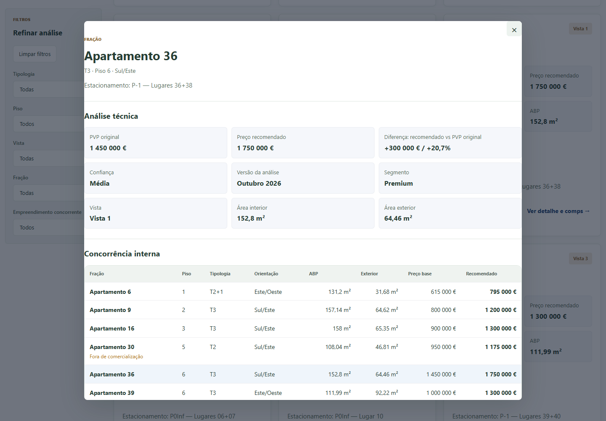
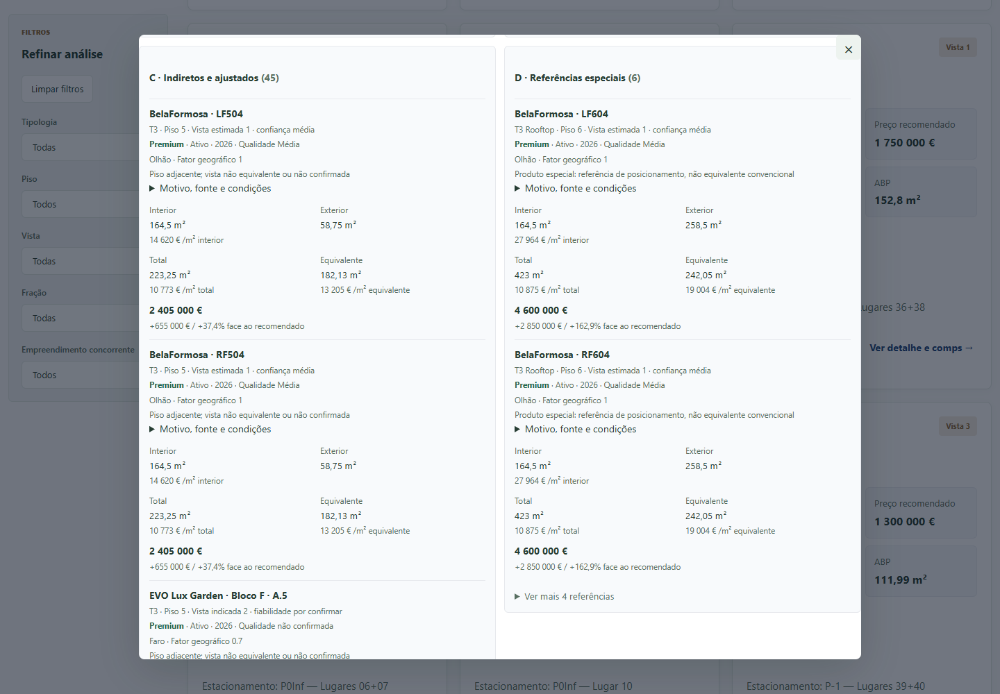
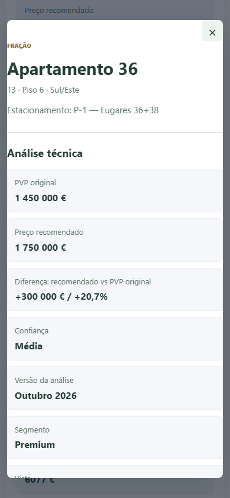
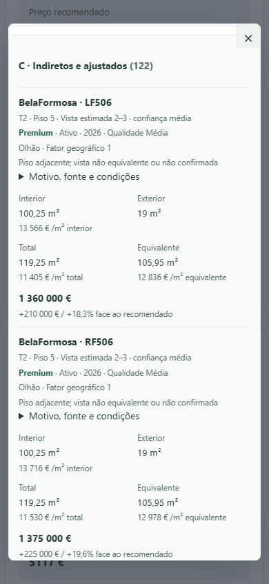
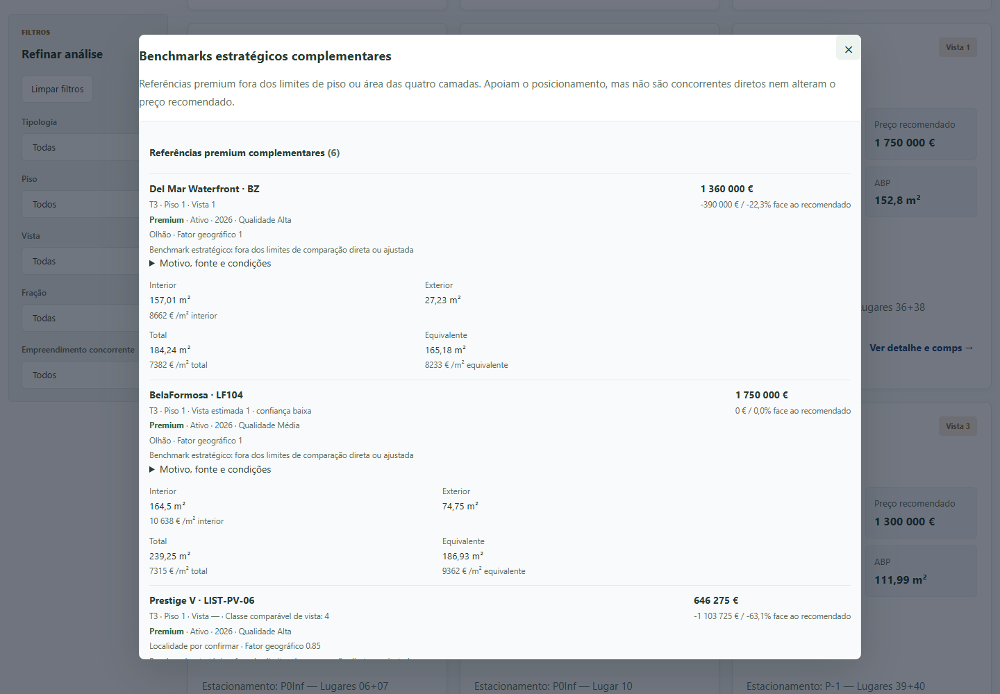
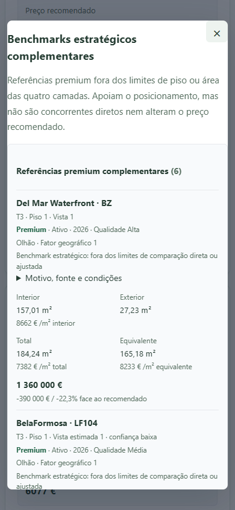
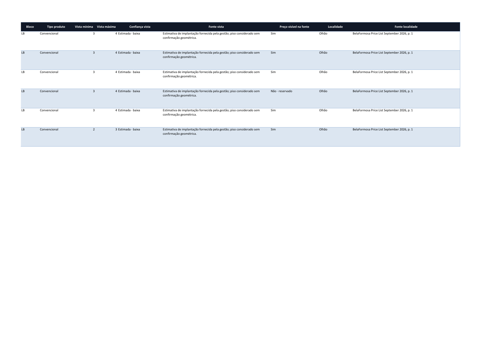
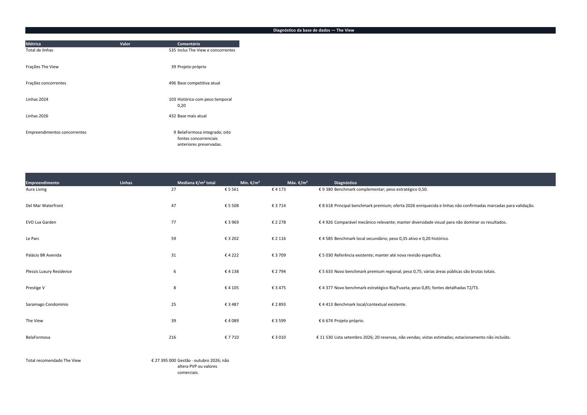

# Comparador BelaFormosa

Capturas locais reais da interface; sem clientes, credenciais ou base Google.
Os precos recomendados sao a analise independente de 29.675.000 EUR. Nao sao os
precos comerciais atuais definidos pela gestao (27.395.000 EUR). Os dados concorrentes
sao a fonte de setembro de 2026, com reservas e vistas estimadas identificadas.

## Desktop: resumo do Apt. 36

## Desktop: convencionais do piso 5 e rooftops separados

## Mobile: resumo

## Mobile: vista estimada e referencias ajustadas do Apt. 37

## Benchmarks complementares, sem duplicacao com A/B/C/D

## Verificacao real no Microsoft Excel 16.0

Modo so de leitura, macros desativadas e sem atualizar ligacoes externas.
Ficheiro fechado sem guardar; SHA-256 identico antes/depois.

[Registo da leitura](excel-reader.json).
As capturas Excel originais e o registo acima sao historicos, anteriores a
correcao da tabela. A captura atual de Resumo BD e apresentada abaixo.

[Validacao da tabela definitiva](independent-prices.json).
Os formatos e os campos cortados encontrados durante a revisao foram corrigidos.
Os dados do CRM e Google nao foram consultados.

[Relatorio](../../BELAFORMOSA_COMPARATOR.md) · [Resultados](validation.json) · [Fonte](source-manifest.json)
