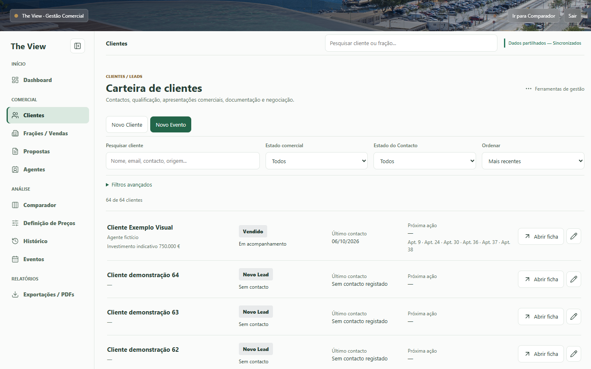
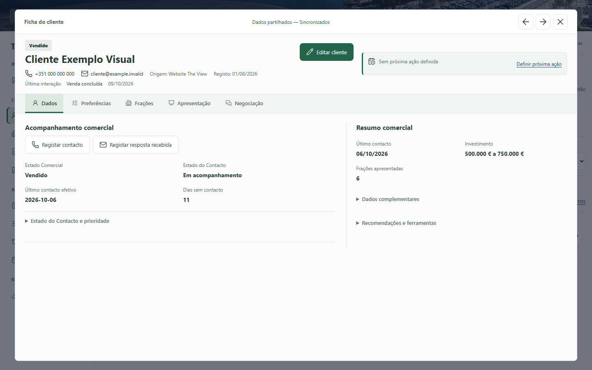

# Carteira de clientes e ficha modal

Capturas reais do Chrome, exclusivamente com dados ficticios. Nenhum dado,
password ou contacto de producao. Base anterior: `5d2c91f`.

## Antes e depois

| Vista | Antes | Depois |
|---|---|---|
| Carteira desktop | [Anterior](before-desktop-portfolio.png) | [Nova carteira](desktop-portfolio.png) |
| Ficha desktop | [Pagina anterior](before-desktop-profile.png) | [Modal](desktop-data.png) |
| Carteira mobile | [Anterior](before-mobile-portfolio.png) | [Nova carteira](mobile-portfolio.png) |
| Ficha mobile | [Pagina anterior](before-mobile-profile.png) | [Modal fullscreen](mobile-data.png) |

## Desktop: 1440x900

## Cinco separadores

| Ecra | Dados | Preferencias em edicao | Fracoes | Apresentacao | Negociacao |
|---|---|---|---|---|---|
| Desktop 1440x900 | [Ver](desktop-data.png) | [Ver](desktop-preferences.png) | [Ver](desktop-fractions.png) | [Ver](desktop-presentation.png) | [Ver](desktop-negotiation.png) |
| Portatil 1366x768 | [Ver](laptop-data.png) | [Ver](laptop-preferences.png) | [Ver](laptop-fractions.png) | [Ver](laptop-presentation.png) | [Ver](laptop-negotiation.png) |
| Tablet 820x1080 | [Ver](tablet-data.png) | [Ver](tablet-preferences.png) | [Ver](tablet-fractions.png) | [Ver](tablet-presentation.png) | [Ver](tablet-negotiation.png) |
| Mobile 390x844 | [Ver](mobile-data.png) | [Ver](mobile-preferences.png) | [Ver](mobile-fractions.png) | [Ver](mobile-presentation.png) | [Ver](mobile-negotiation.png) |

## Agentes e regresso a carteira

| Ecra | Clientes associados ao agente | Regresso com filtro e ordem preservados |
|---|---|---|
| Desktop | [Ver](desktop-agents.png) | [Ver](desktop-return.png) |
| Portatil | [Ver](laptop-agents.png) | [Ver](laptop-return.png) |
| Tablet | [Ver](tablet-agents.png) | [Ver](tablet-return.png) |
| Mobile | [Ver](mobile-agents.png) | [Ver](mobile-return.png) |

As imagens mostram a parte visivel do ecra. No modal, o conteudo tem scroll
independente e as abas mantem-se acessiveis; no mobile, a linha de abas permite
scroll horizontal. Formulario de preferencias com multisselecao real, nao modal
legado. Capturas feitas por `tests/client-workspace-browser.mjs`.

[Relatorio e reproducao](../../CLIENT_AGENT_WORKSPACE.md).
