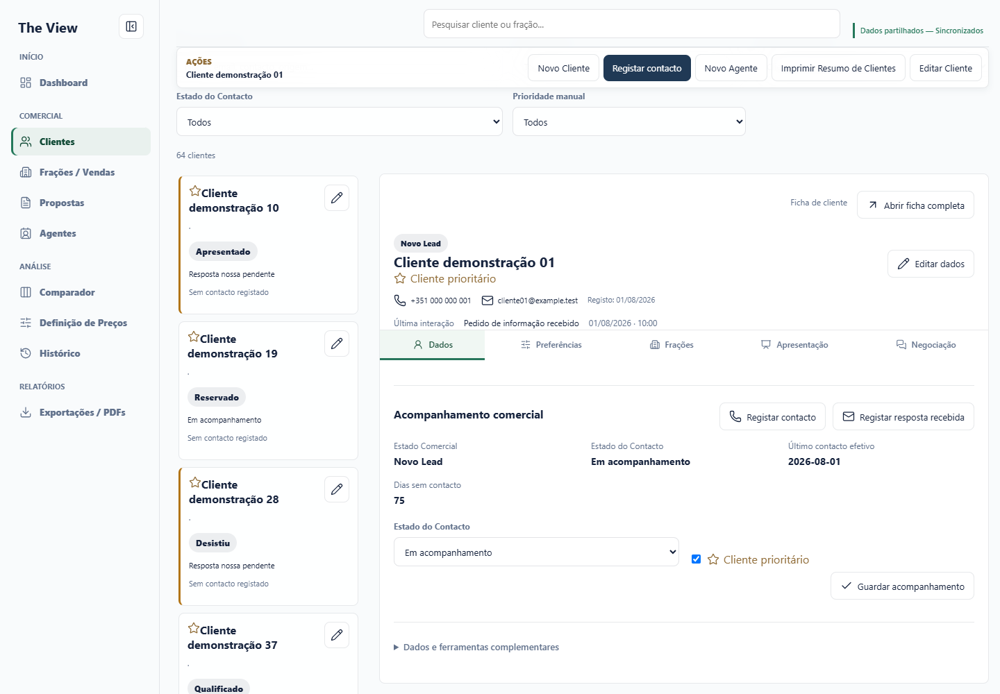
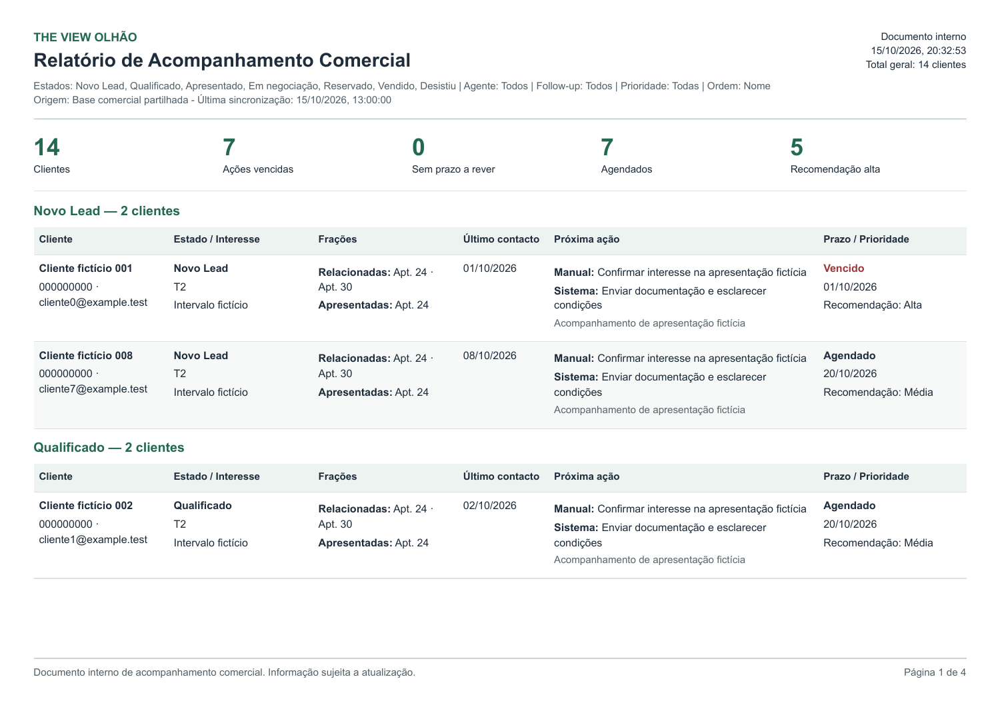
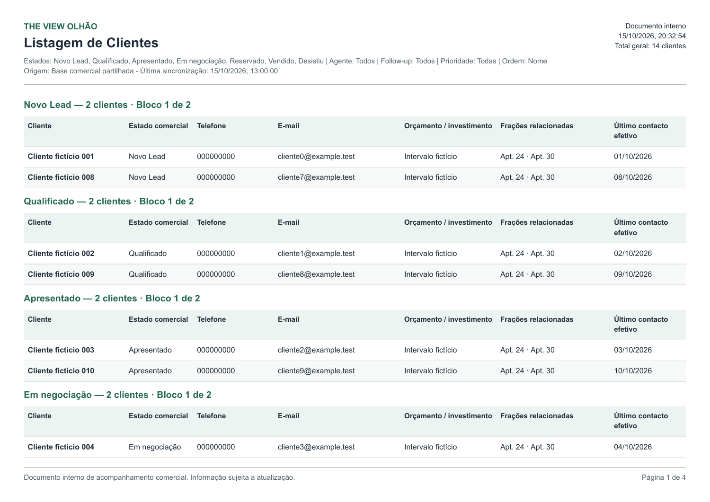

# Lista continua e agrupamento nos PDFs

Correcao sobre main apos a PR #8. Sem alteracoes nos dados ou nos estados dos clientes.

## Alteracoes

- Dashboard: uma unica renderizacao dos cartoes, sem cabecalhos/contagens por Estado. Preservados contador geral, estado no cartao, prioridade manual, Estado do Contacto, ultimo contacto, pesquisa, filtros, ordenacao global do modelo portfolio e abertura/edicao da ficha.
- Acompanhamento Comercial e Listagem Completa: grupos nao vazios na ordem oficial STAGES, construidos a partir das linhas ja filtradas/ordenadas. Cabecalho com nome e contagem do grupo; total geral permanece no relatorio.
- Listagem com varios blocos: cada bloco contem os mesmos grupos e cada cliente uma unica vez. A escolha de colunas e a ordem interna de cada grupo sao preservadas.
- Paginacao: grupos consecutivos podem partilhar a pagina. Apenas uma mudanca de bloco de colunas inicia outra pagina; a medicao existente continua a repetir titulos/cabecalhos e a dividir texto excecionalmente longo sem o perder.
- Resumo de Gestao e Carteira Comercial por Estado: corpos HTML comparados byte a byte com a main, sem alteracoes.
- Removidas duas regras CSS que ficaram sem utilizacao. Deployment Git automatico desativado apenas para a branch corretiva.

## Evidencias ficticias

[Dashboard: lista continua](dashboard-lista-continua.png) · [Lista em mobile](dashboard-lista-mobile.png)

| Relatorio | PDF real A4 | Capturas renderizadas do PDF |
| --- | --- | --- |
| Acompanhamento Comercial | [Abrir PDF](acompanhamento-comercial.pdf) | [Pagina 1](acompanhamento-1.png) · [Pagina 2](acompanhamento-2.png) |
| Listagem de Clientes | [Abrir PDF](listagem-clientes.pdf) | [Pagina 1](listagem-1.png) · [Pagina 2](listagem-2.png) |

## Validacao

- 26 suites Node passaram, incluindo testes novos de sete estados, contagens apos filtros combinados, todos os criterios de ordenacao, ausencia de grupos vazios, todas as colunas e preservacao de management/portfolio. node --check commercial.js, app.js e config.js aprovado.
- Chrome real: ordem da lista identica ao modelo portfolio global; sem cabecalhos ou contagens por Estado; pesquisa/filtros/prioridade/contactos, abrir/editar ficha e modal real de ambos os PDFs funcionais. Zero erros JavaScript e zero gravacoes comerciais; dados/revisao ficticios inalterados.
- Dois PDFs de exemplo, 14 clientes/7 estados, com 4 paginas cada; Listagem dividida em 2 blocos, cada cliente exatamente uma vez por bloco.
- Sete grupos pequenos cabem numa unica pagina. Relatorios sem resultados mostram mensagem explicita, sem grupos vazios. Filtro parcial/combinado produz uma unica pessoa/grupo no cenario testado.
- Relatorio extenso: 98 clientes, 7 estados, 4 blocos e 33 paginas; nenhum cliente omitido/duplicado por bloco, sem cabecalhos isolados, paginas vazias ou transbordos. Texto longo num unico cliente atravessa 8 paginas e conserva o marcador final.
- PDFs gerados pelo HTML/paginador real, contagem de paginas verificada com pdf-lib/pypdf e capturas renderizadas por Poppler. [Resultados detalhados](results.json).

Reproducao: `node tests/commercial-client-report-grouping.test.js`. Para browser, iniciar `node tests/helpers/client-report-grouping-preview.cjs` na porta 5200 e executar `node tests/commercial-client-report-grouping-browser.mjs`, com PLAYWRIGHT_MODULE, PDF_LIB_MODULE e CHROME_EXECUTABLE conforme o runtime local. Sao usados apenas clientes ficticios e Apps Script simulado em memoria; nunca apontar estes testes para producao.

## Preservacao

API, Apps Script, autenticacao, sincronizacao, precos/estados das fracoes, cinco separadores e navegacao das PRs #7/#8 nao foram alterados. Nenhuma migracao, acesso a dados reais, merge, deployment ou promocao foi realizado. As evidencias nao certificam a versao de um deployment remoto.
