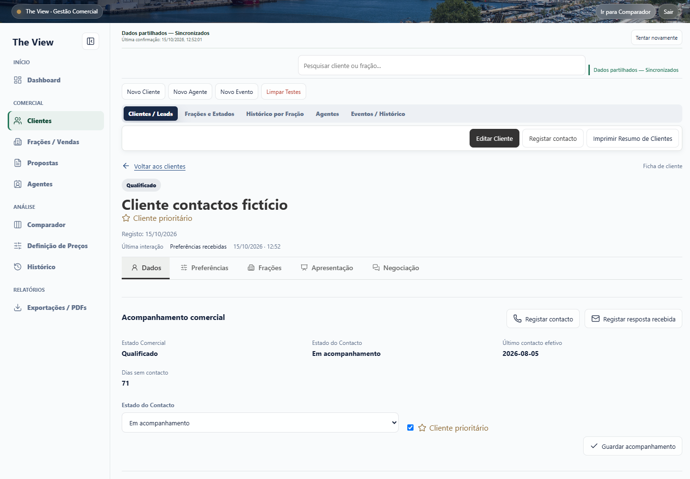
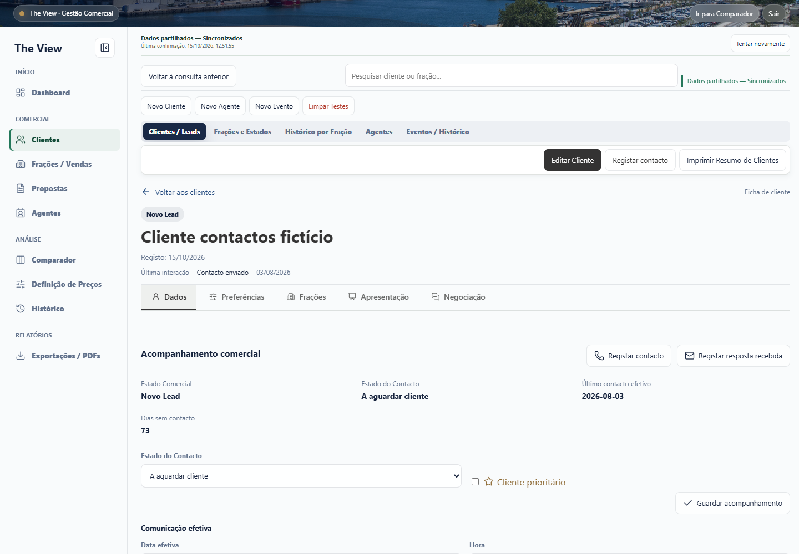
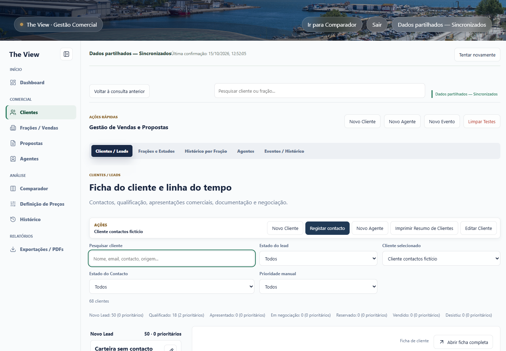
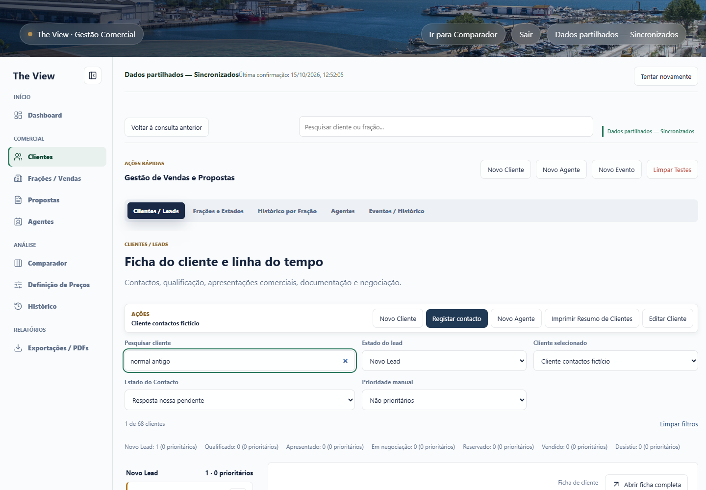
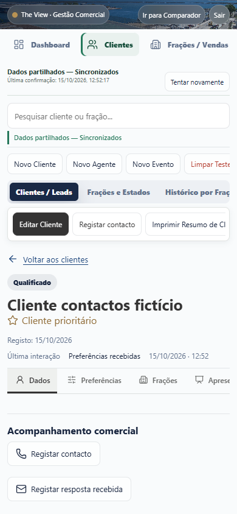
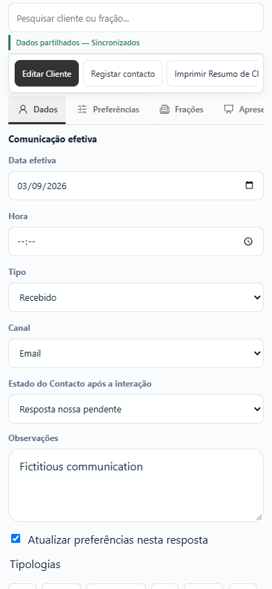
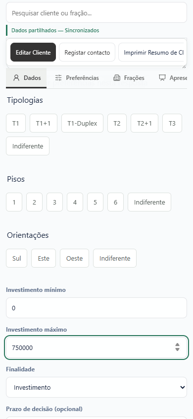
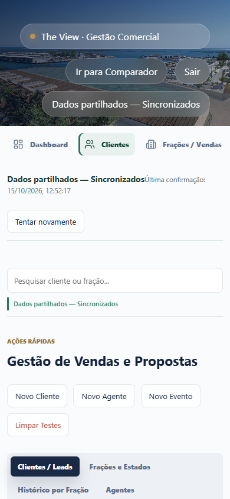

# Ficha comercial completa: validação visual

Capturas reais de Chrome com dados exclusivamente fictícios. API autenticada e Apps Script em memória; sem acesso à Google Sheet real. Não são mockups.

## Contactos e Carteira Comercial

[Resultados dos novos contactos e prioridades](contacts-results.json).

## Computador

## Telemóvel

## Tablet

[Resultados da jornada](validation-results.json) · [Resultados das exportações](exports-results.json) · [23 suites e preservação do protocolo](regression-results.json) · [Relatório técnico, reprodução e limites](../../CLIENT_PROFILE_COMPLETE.md)
