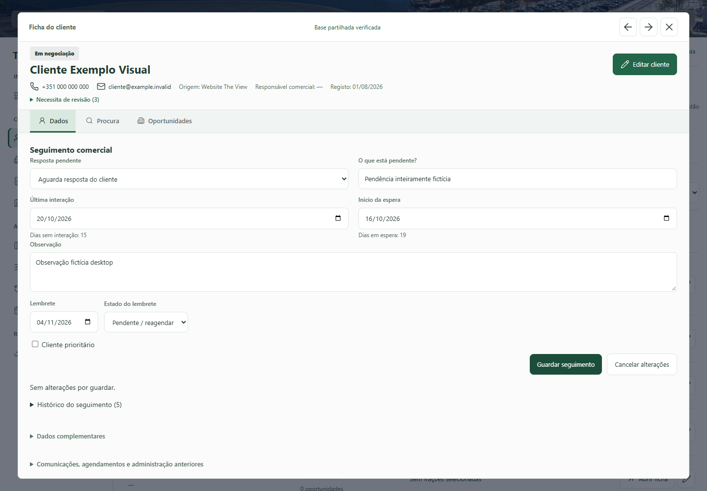
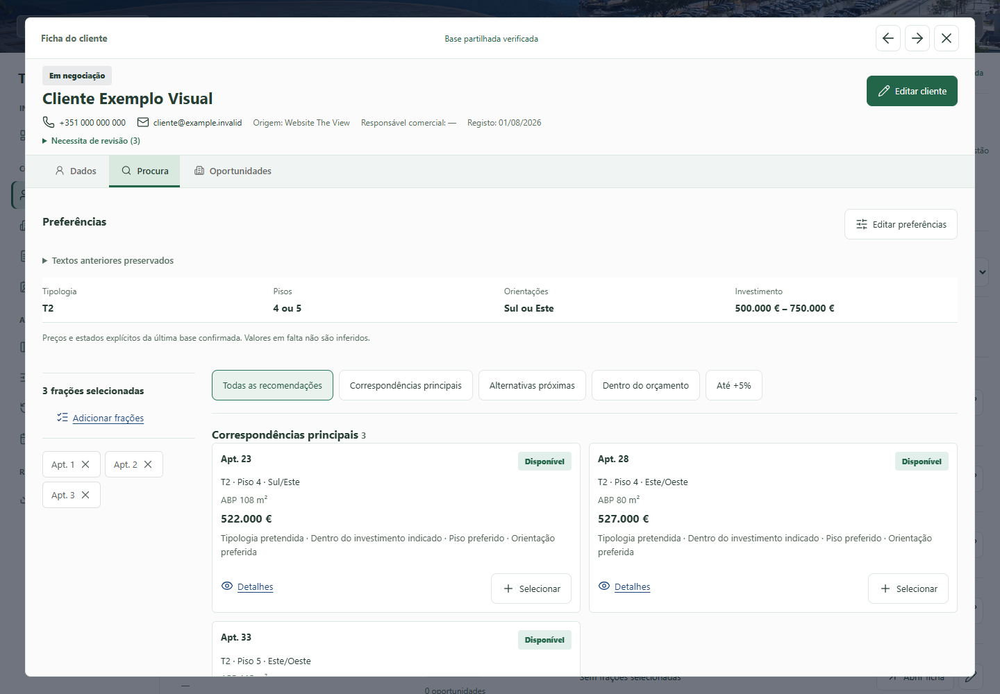
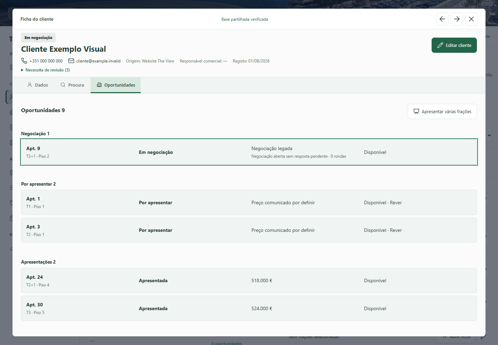
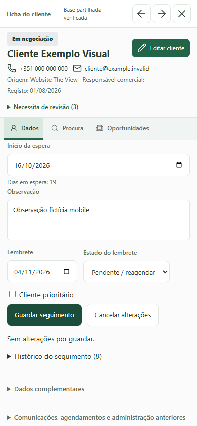
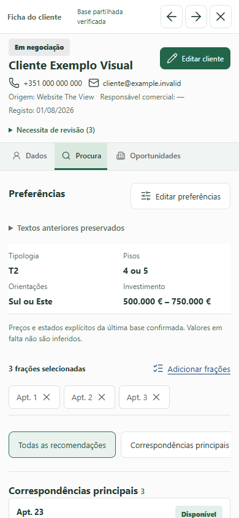
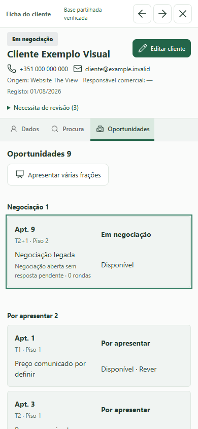

# Ficha de cliente: galeria de validacao

Capturas reais de Chrome, exclusivamente com clientes, contactos, eventos,
precos e disponibilidades ficticios. Nenhum pedido a producao. A imagem de fundo
e os ativos da aplicacao sao os existentes; a identidade D2 nao foi substituida.

Antes: main `8c5026c`. Depois: branch `codex/client-profile-followup-ux`.
A fixture depois inclui uma recusa e uma visita adicionais para testar os novos
percursos, nao alteracoes comerciais reais. Os valores nao representam o catalogo.

## Desktop: 1440 x 1000

| Separador | Antes | Depois |
| --- | --- | --- |
| Dados | [Abrir](before/desktop-dados.png) | [Abrir](after/desktop-dados.png) |
| Procura | [Abrir](before/desktop-procura.png) | [Abrir](after/desktop-procura.png) |
| Oportunidades | [Abrir](before/desktop-oportunidades.png) | [Abrir](after/desktop-oportunidades.png) |

[Resumo/sidebar durante o scroll](after/desktop-procura-scroll.png) e
[detalhe sobreposto](after/desktop-oportunidade.png).

## Mobile: 390 x 844

| Separador | Antes | Depois |
| --- | --- | --- |
| Dados | [Abrir](before/mobile-dados.png) | [Abrir](after/mobile-dados.png) |
| Procura | [Abrir](before/mobile-procura.png) | [Abrir](after/mobile-procura.png) |
| Oportunidades | [Abrir](before/mobile-oportunidades.png) | [Abrir](after/mobile-oportunidades.png) |

[Barra compacta durante o scroll](after/mobile-procura-scroll.png) e
[detalhe fullscreen](after/mobile-oportunidade.png).

## Portatil e Tablet

| Formato | Dados | Procura | Oportunidades | Detalhe | Scroll |
| --- | --- | --- | --- | --- | --- |
| 1366 x 768 | [Abrir](after/laptop-dados.png) | [Abrir](after/laptop-procura.png) | [Abrir](after/laptop-oportunidades.png) | [Abrir](after/laptop-oportunidade.png) | [Abrir](after/laptop-procura-scroll.png) |
| 820 x 1080 | [Abrir](after/tablet-dados.png) | [Abrir](after/tablet-procura.png) | [Abrir](after/tablet-oportunidades.png) | [Abrir](after/tablet-oportunidade.png) | [Abrir](after/tablet-procura-scroll.png) |

Ver [matriz e relatorio](../../CLIENT_PROFILE_FOLLOWUP_UX.md). Os ficheiros JSON
de evidencia contem so contagens, nomes de suites e resultados, nunca a base CRM.
Viewports simulados nao substituem ensaios em Safari/iOS ou Firefox reais.
