# PR #3 - Validacao visual da ficha de cliente

Capturas reais de navegador, nao mockups. Todos os clientes, contactos, agente e eventos sao ficticios. Testes em contexto de navegador novo, autenticado com password de teste, servidor local e Google simulado em memoria. Escrita remota bloqueada no servidor e na fonte; pedidos a hosts externos bloqueados no browser. Nenhuma Google Sheet ou credencial de producao foi usada.

## Correcoes verificadas

- A listagem mantem pesquisa, estado do lead, cliente selecionado, scroll da lista e painel do cliente com cinco abas operacionais. O botao "Abrir ficha completa" continua disponivel.
- A consulta de estado com cliente, preco informado, data e observacao por fracao foi reposta, juntamente com o orcamento indicativo legado.
- "Alternativas proximas" indica que o novo motor sera disponibilizado na Fase 2; nao afirma que foram avaliadas todas as alternativas.
- API, sincronizacao e funcoes comerciais de gravacao permanecem inalteradas.

## Refinamento final - barras compactas

Exclusivamente na ficha completa: marca/navegacao superior compacta, menor espacamento entre barras, acoes rapidas e navegacao interna em linhas com scroll horizontal quando necessario. Todos os modulos e as quatro acoes rapidas continuam acessiveis. Os detalhes/avisos e controlos de sincronizacao nao foram escondidos; apenas o indicador duplicado do topo deixa de aparecer nesta vista.

"Editar Cliente" e a unica acao principal de edicao dos dados, na barra sticky. Os atalhos duplicados do cabecalho e do painel Dados ficam ocultos apenas na ficha completa. Editar preferencias e as outras acoes especializadas continuam disponiveis. Ao fechar a ficha ou mudar de modulo/subarea, regressa o estilo anterior.

Comparacao automatizada com o CSS do commit aprovado `93f509d`: dimensoes/estilos da listagem iguais antes de abrir e depois de regressar. No cliente ficticio completo, com a pagina no topo:

| Viewport | Inicio dos separadores antes | Depois |
| --- | ---: | ---: |
| Desktop 1440x1000 | 818 px | 524 px |
| Tablet 820x1080 | 875 px | 524 px |
| Mobile 390x844 | 1366 px | 647 px |

Capturas da ficha completa/transicao atualizadas abaixo. As imagens da listagem/regresso aprovadas anteriormente foram mantidas, pois essa experiencia nao foi alterada. [Resultados da regressao no navegador](validation-results.json), exclusivamente com dados ficticios e sem escritas comerciais.

## Computador - 1440 x 1000

Listagem inicial, com painel lateral acessivel:

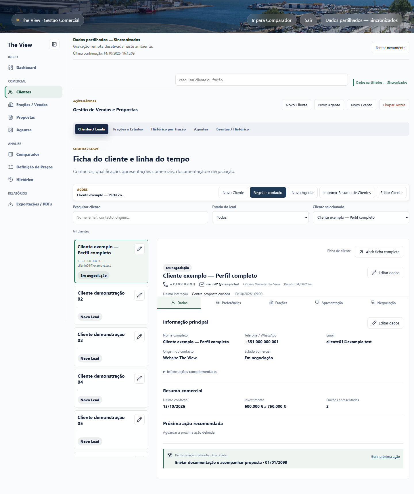

Transicao para a ficha completa:

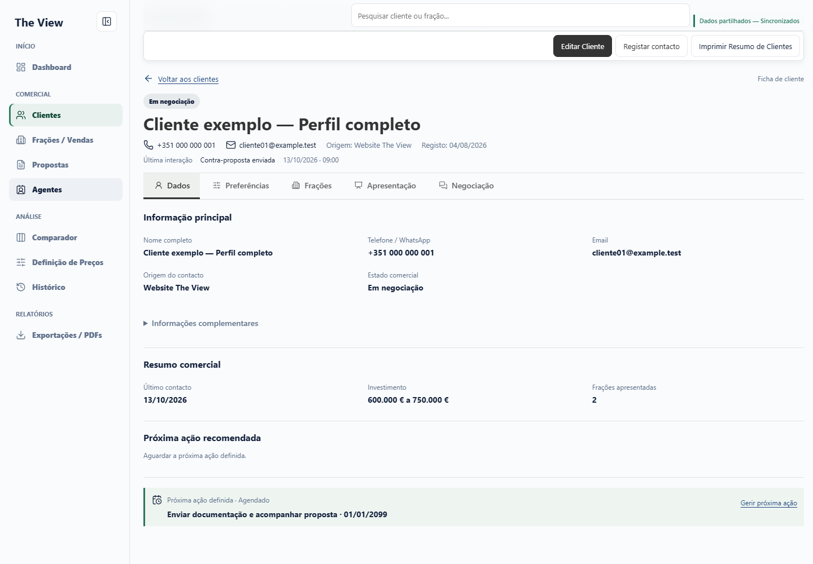

### Dados

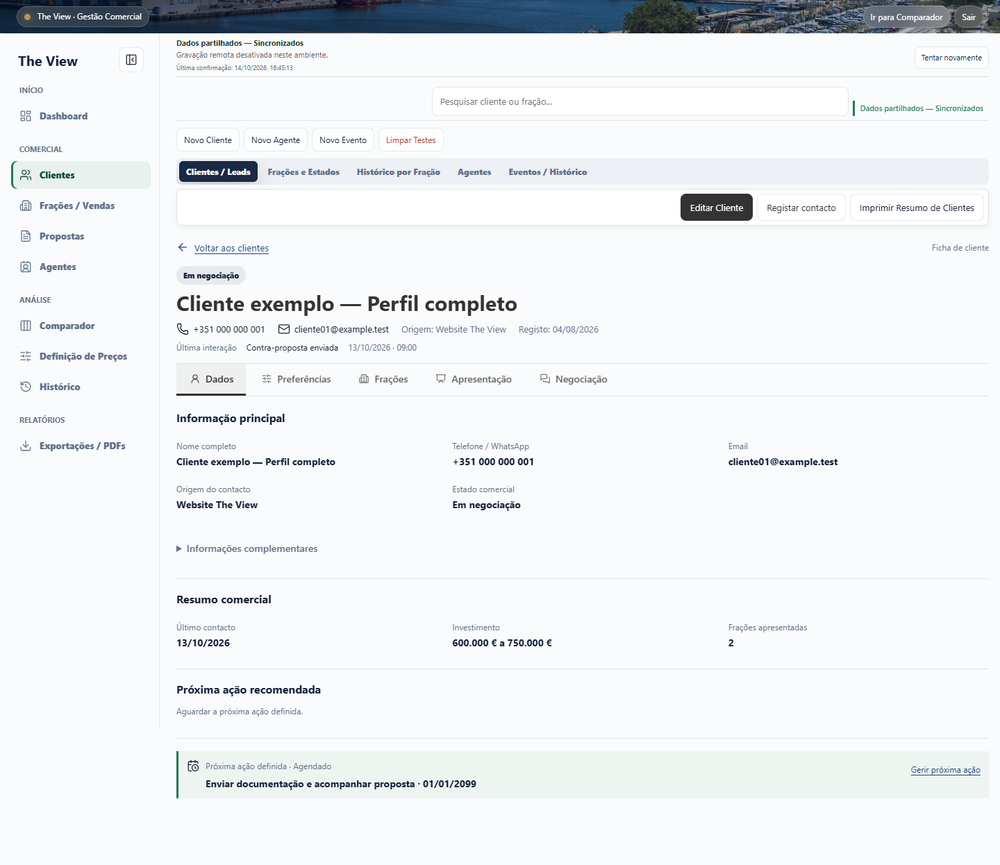

### Preferencias

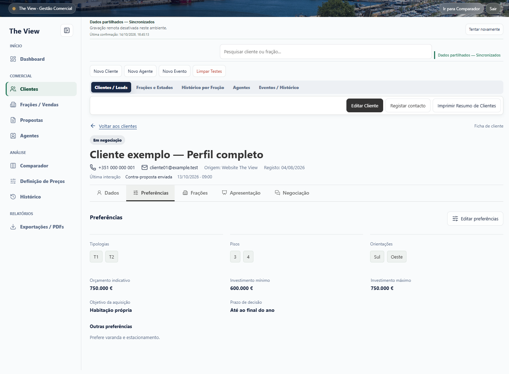

### Fracoes

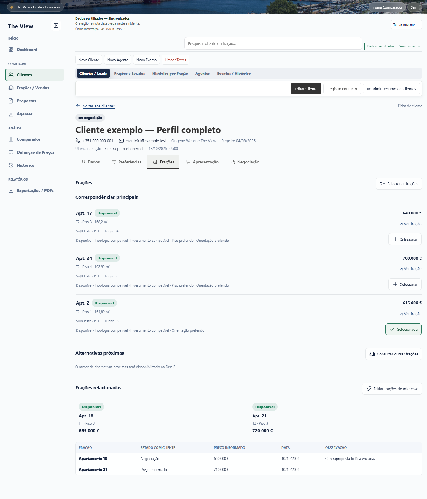

### Apresentacao

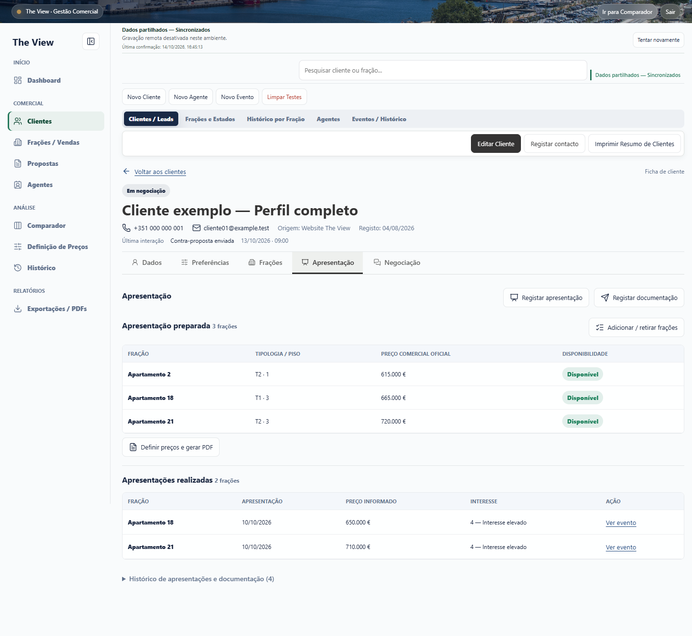

### Negociacao

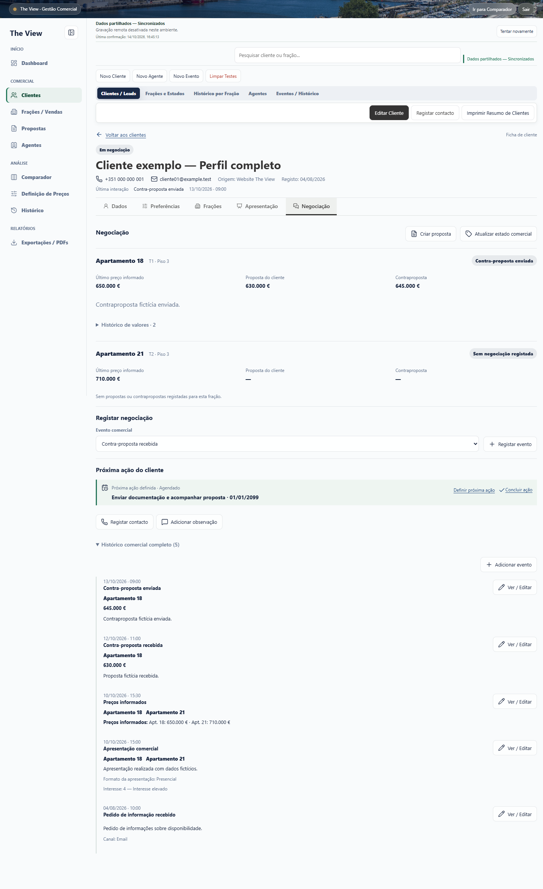

Regresso: pesquisa "Cliente exemplo", estado "Em negociacao", cliente selecionado e painel operacional preservados:

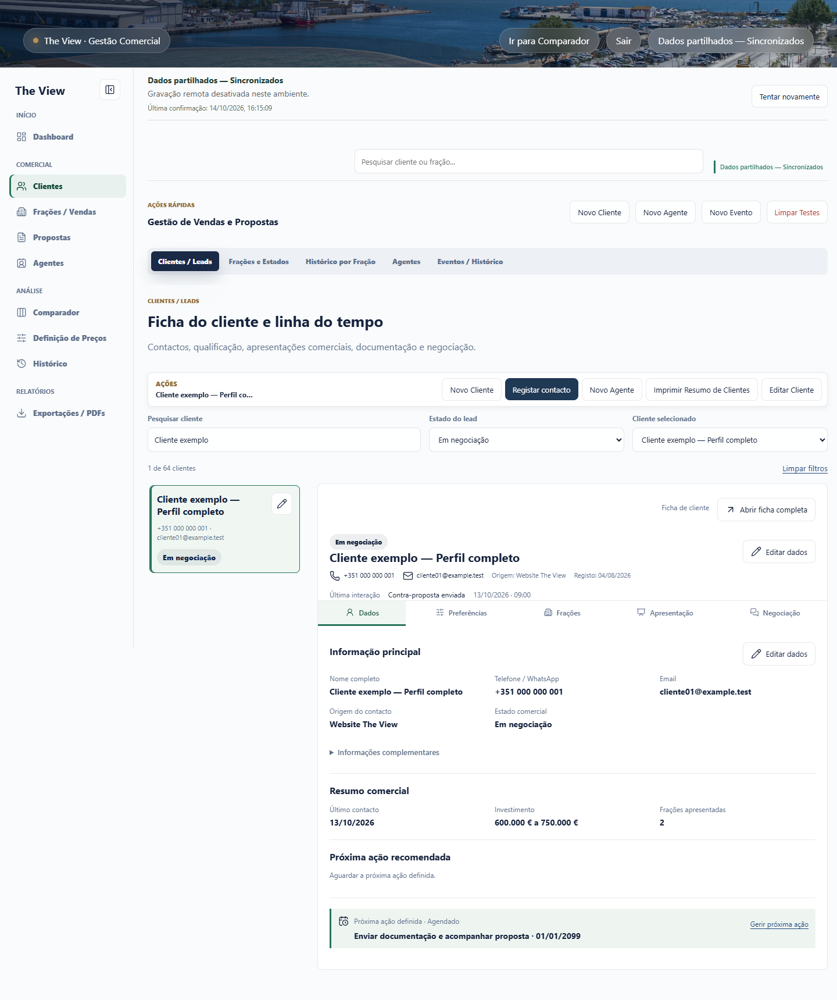

## Telemovel - 390 x 844

As abas e a barra de acoes usam scroll horizontal. Estas capturas mostram a navegacao real com a aba ativa visivel; nao foram recompostas. As capturas completas permitem consultar o conteudo abaixo da primeira janela.

Listagem inicial:

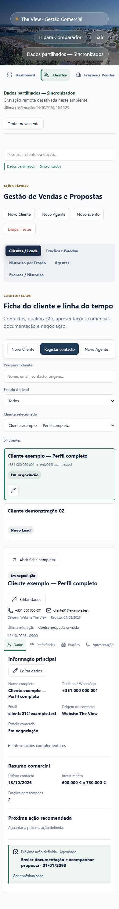

Transicao para a ficha:

### Dados

[Ver pagina completa](mobile-dados.png)

### Preferencias

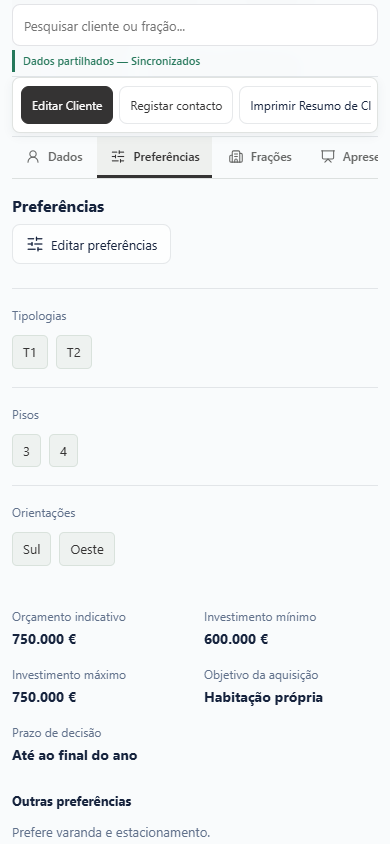

[Ver pagina completa](mobile-preferencias.png)

### Fracoes

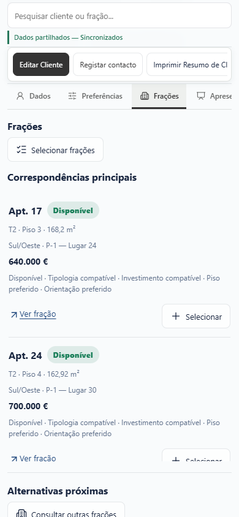

[Ver pagina completa e mensagem da Fase 2](mobile-fracoes.png)

### Apresentacao

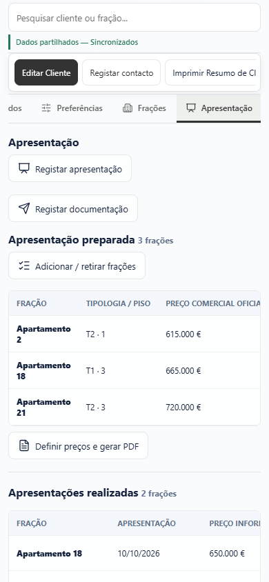

[Ver pagina completa](mobile-apresentacao.png)

### Negociacao

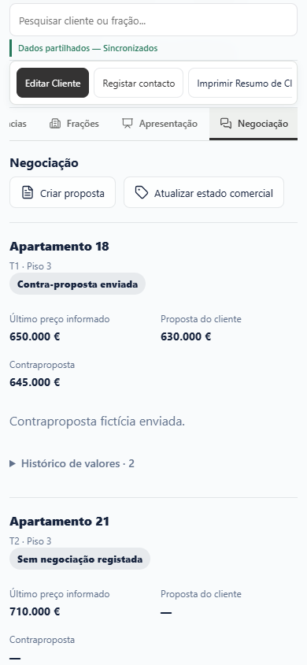

[Ver pagina completa e eventos](mobile-negociacao.png)

Regresso a listagem:

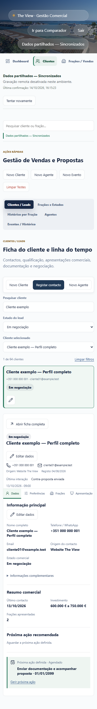

## Resultados e limites

- 64 clientes ficticios, cinco eventos ficticios e um agente ficticio.
- Desktop 1440x1000, tablet 820x1080 e mobile 390x844 aprovados: cinco abas, transicao, retorno, filtros, selecao e scroll; modais de preferencias/apresentacao/edicao de evento; clientes incompletos e valores "Indiferente".
- Zero erros JavaScript, zero POST comerciais, zero escritas na fonte. JSON comercial no localStorage identico antes/depois da navegacao. Sem overflow horizontal da pagina ou sobreposicao das abas sticky com a barra de acoes.
- Testes direcionados `commercial-client-tabs`, `commercial-progressive-flow`, `commercial-ux` e `node --check commercial.js` aprovados. Comparacao de fonte confirmou sincronizacao e nove funcoes comerciais identicas a `db097c8`.
- Nao se testou producao nem se guardaram alteracoes de clientes reais. Abertura/cancelamento de modais valida acessibilidade, nao substitui um teste futuro de gravacao deliberada num ambiente isolado de escrita.
- Refinamento final: navegacao por Dashboard, Fracoes/Vendas, Agentes, Propostas, Comparador, Precos, Historico e Relatorios; unica edicao principal funcional; estilo original restaurado fora da ficha; mesmas dimensoes da listagem face ao CSS aprovado; modais acessiveis. JavaScript comercial permaneceu identico ao commit anterior.
- Capturas de pagina completa incluem zonas abaixo do viewport indicado; os ficheiros `*-navegacao.png` e `*-transicao.png` sao capturas do viewport.

Para rever manualmente: comparar listagem inicial/regresso; verificar os cinco separadores; confirmar a mensagem da Fase 2 e a tabela anterior em Fracoes. Nao fazer merge nem deployment antes da aprovacao visual.
