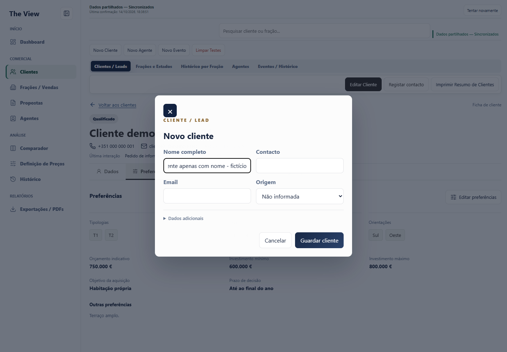
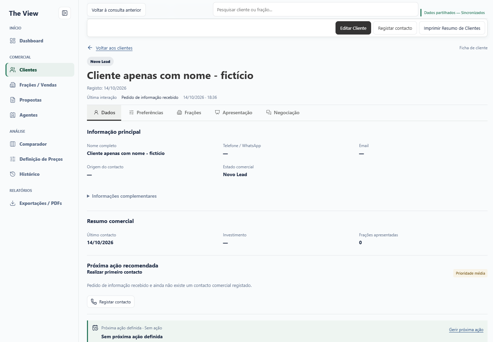
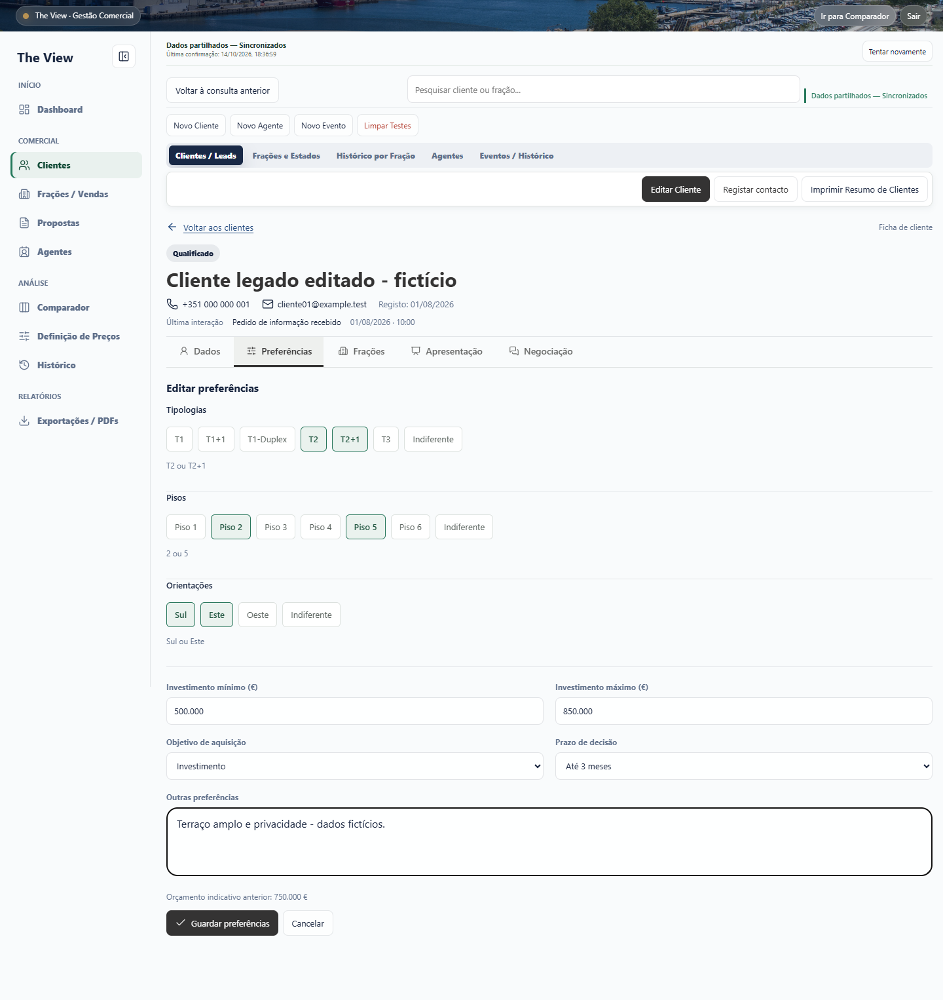
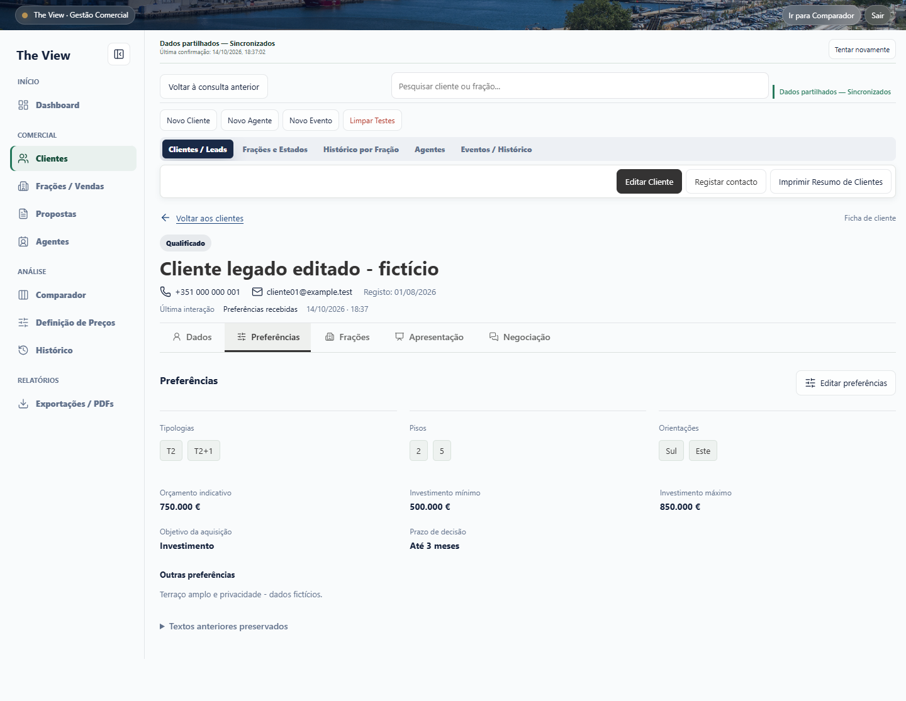
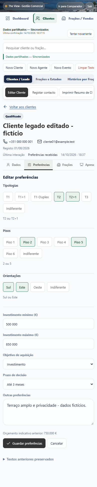
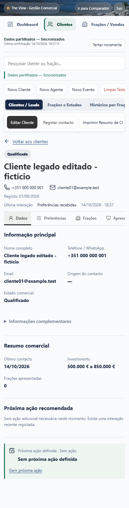
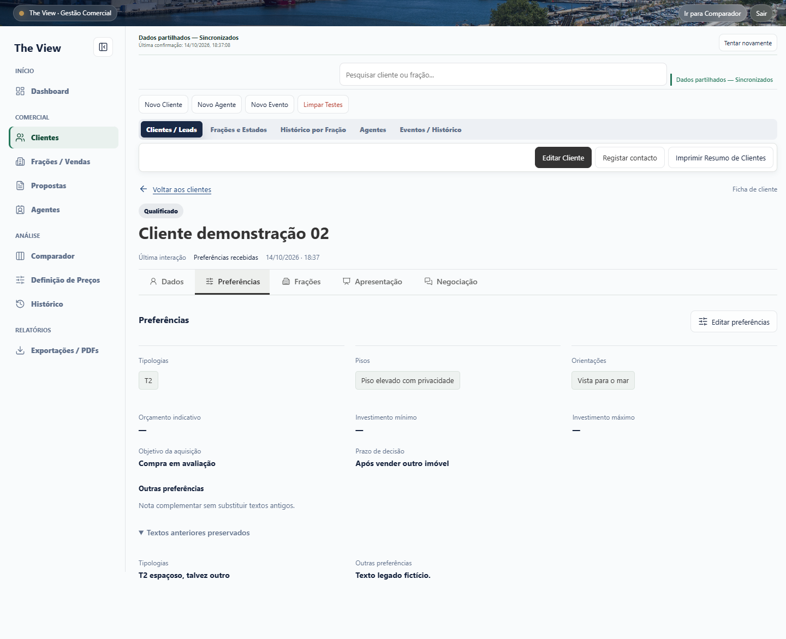
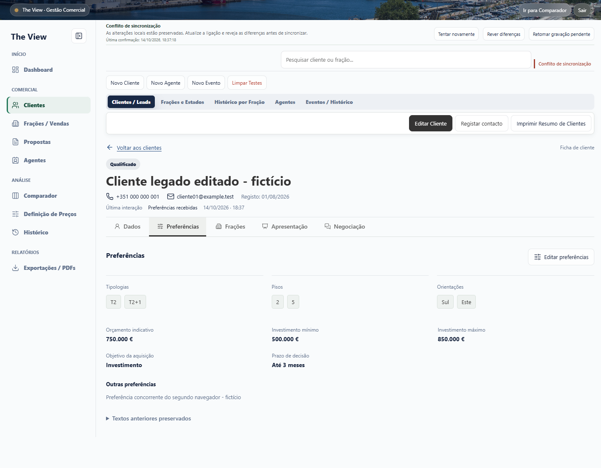

# Fase 2A - Galeria de validacao

Capturas reais de Chromium, com 64 clientes iniciais exclusivamente ficticios e API autenticada contra Apps Script simulado em memoria. Nenhuma leitura/escrita da base Google real nem credencial de producao. Desktop 1440x1000 e mobile 390x844; algumas imagens incluem toda a altura da pagina.

Os valores apresentados sao exemplos de teste. Todos os passos, modelo e limites estao em [CLIENT_PROFILE_PHASE2A.md](../../CLIENT_PROFILE_PHASE2A.md). O resultado automatizado esta em [validation-results.json](validation-results.json).

## Criacao apenas com nome

Origem nao informada; telefone/email opcionais. Depois de guardar, ficha aberta em Novo Lead, com data de registo e um unico evento inicial.

## Preferencias multiples

Edicao dentro do separador: T2/T2+1, pisos 2/5, Sul/Este, investimento minimo/maximo e restante informacao. Orçamento anterior mantido separadamente.

## Compatibilidade com textos antigos

Escolha explicita T2; texto ambiguo anterior continua consultavel. Piso/orientacao livres nao foram convertidos automaticamente.

## Conflito e falha de gravacao

Segundo navegador com alteracao concorrente: 409, primeira versao intacta e segunda copia local preservada. Navegador sem alteracoes recebeu a atualizacao remota sem conflito nem escrita extra.

Falha de escrita exclusivamente simulada: estado sem confirmacao e alteracoes locais preservadas, sem falso sucesso.

## Resultado

20 suites de regressao/modelo e verificacoes de sintaxe aprovadas. Browser: criacao simples/completa/integrada no evento, ID/data preservados, preferências multiple/legadas, modal antigo, refresh, concorrencia e falha de escrita aprovados; zero erros JavaScript e zero pedidos de producao. Abrir/guardar sem alteracao: zero escritas.

Reproducao: iniciar o helper local conforme documentacao e executar o teste de browser. A fonte e temporaria e exclusiva de testes. Esta entrega nao inclui merge, deployment nem Fase 2B.
