# Fase 2B: galeria de validação

Capturas reais de Chrome com a aplicação atual, 64 clientes iniciais fictícios, características estruturais das 39 frações e preços/estados exclusivamente fictícios. API autenticada local e Apps Script em VM; nenhuma Google Sheet real foi utilizada.

Desktop: 1440x1000. Mobile: 390x844. Algumas imagens desktop capturam a área completa do separador, incluindo conteúdo abaixo da janela. A preferência é alterada de T2 para T1 durante o teste; as capturas mobile refletem essa alteração e a mudança fictícia do Apt. 24 para Reservado.

[Regras, ficheiros e reprodução](../../CLIENT_PROFILE_PHASE2B.md) · [Resultados Fase 2B](validation-results.json) · [Regressão Fase 2A](phase2a-regression-results.json)

## Correspondências principais

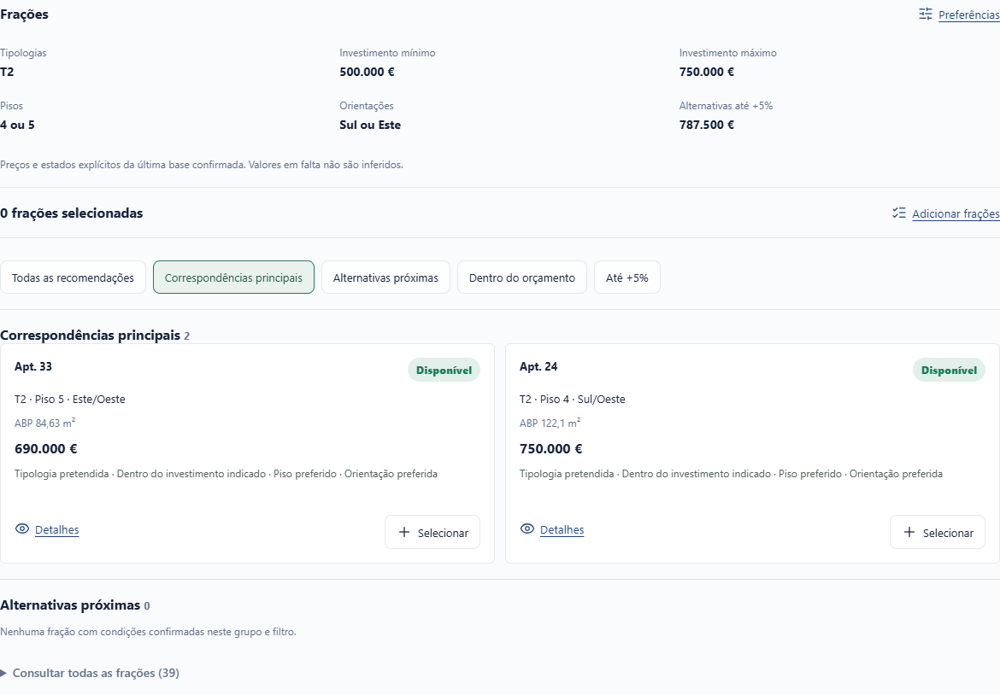

## Alternativas até 5%

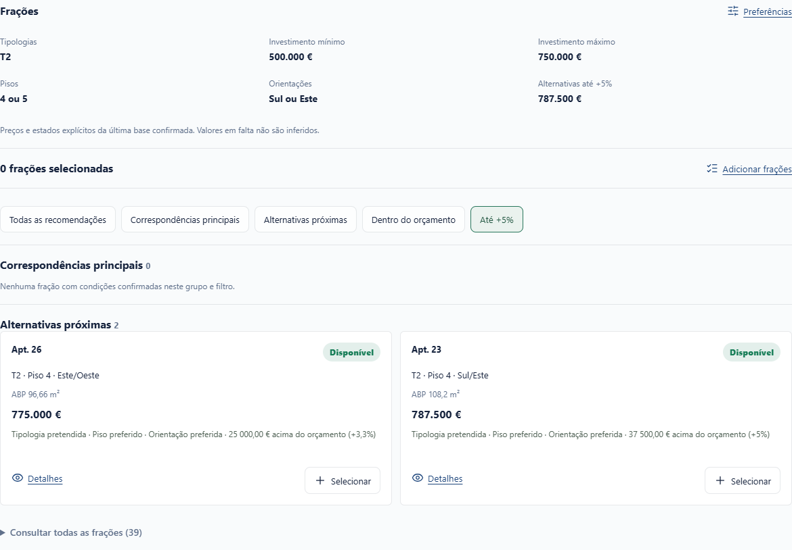

## Preço sem confirmação

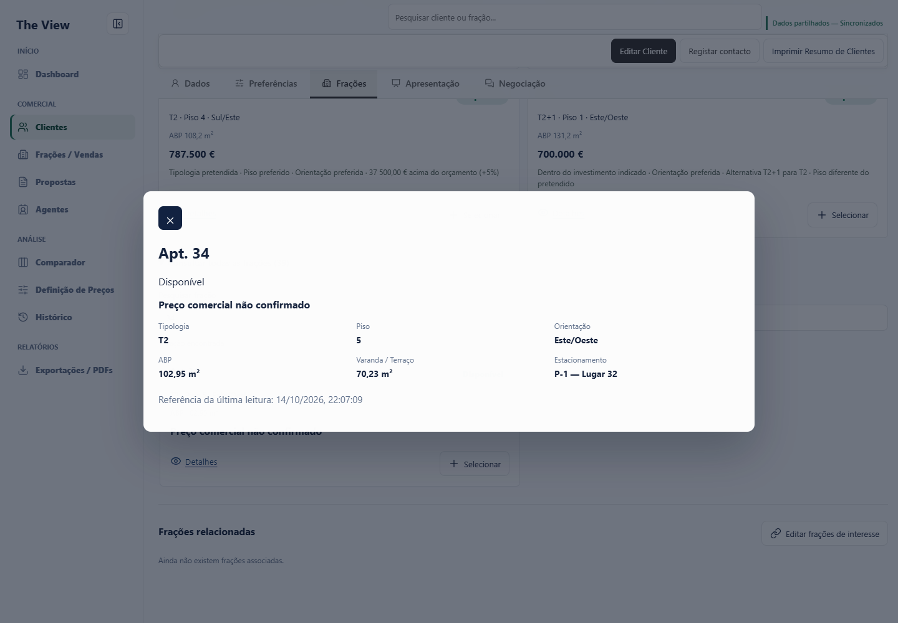

## Consulta e seleção manual

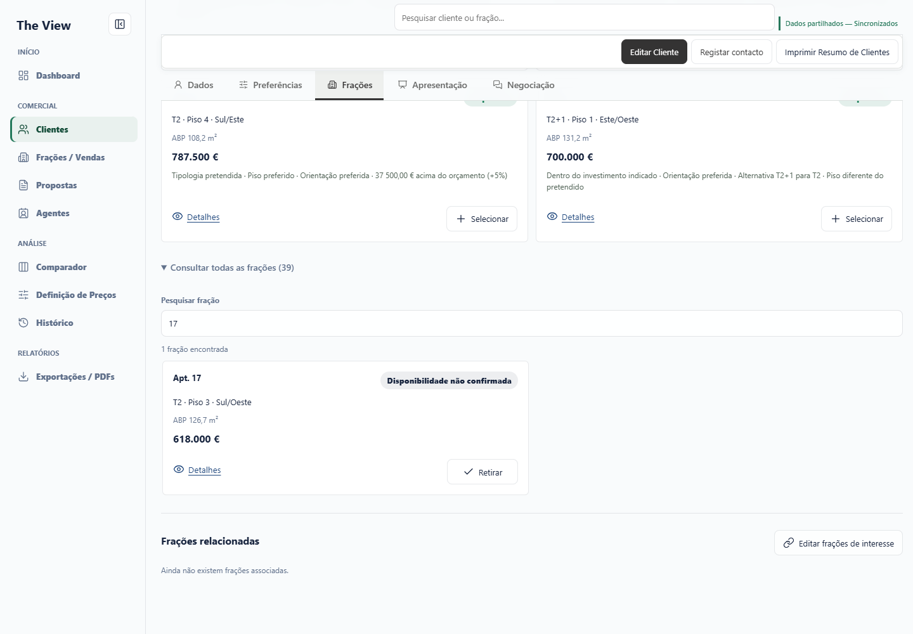

## A mesma seleção em Apresentação

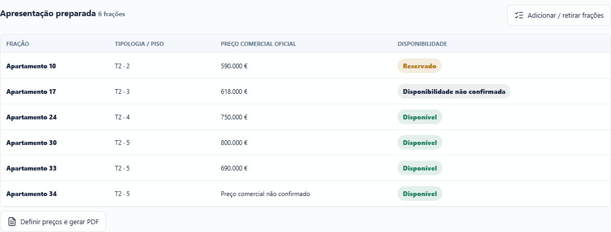

## Mudança de estado

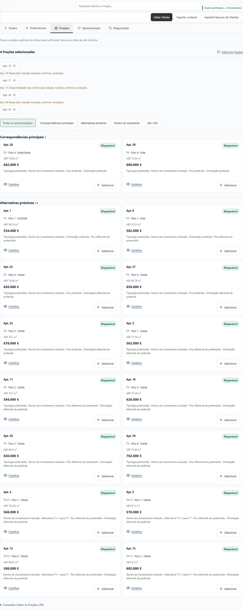

## Falhas e concorrência

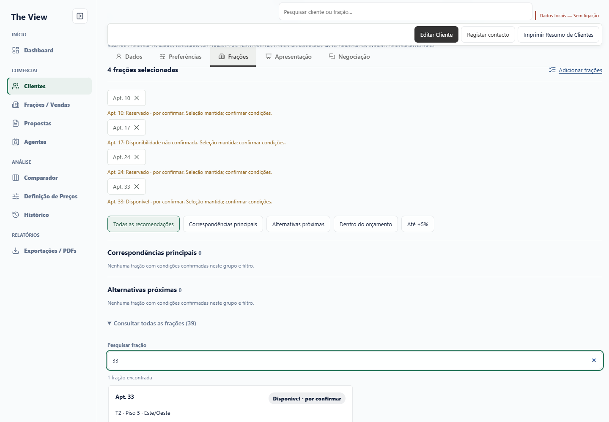

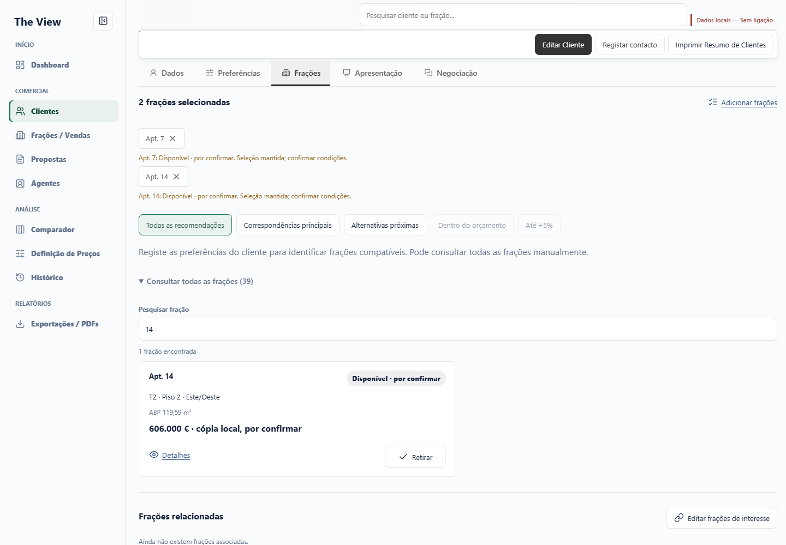

## Telemóvel

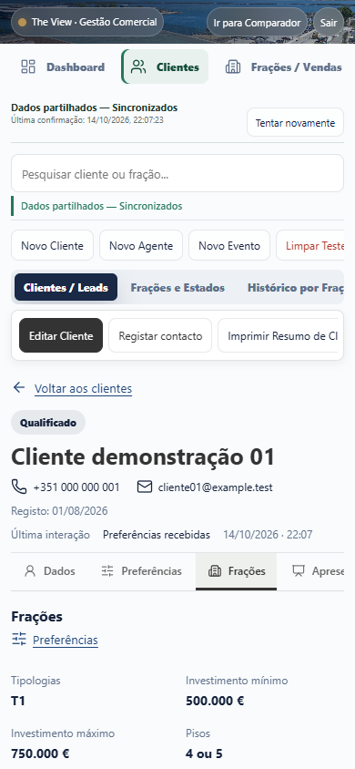

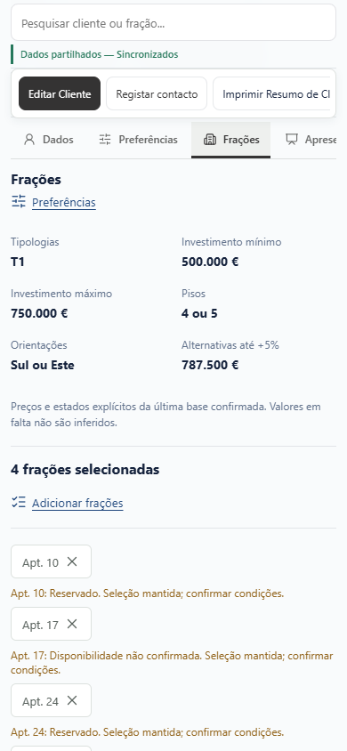

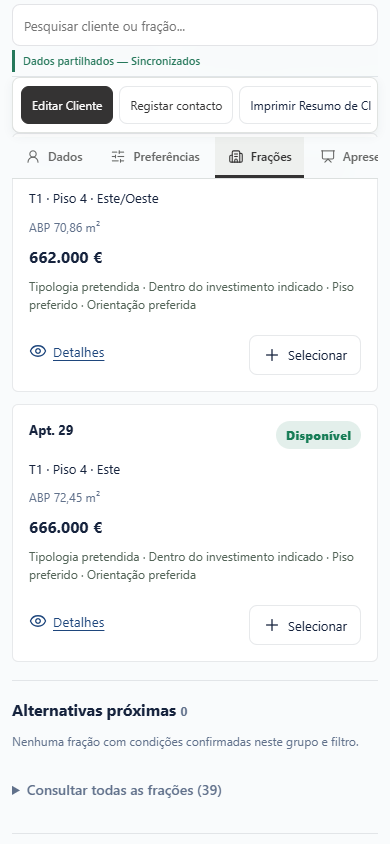

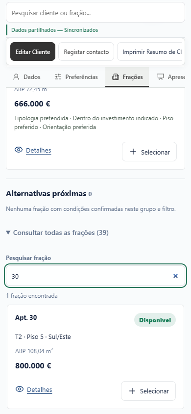
