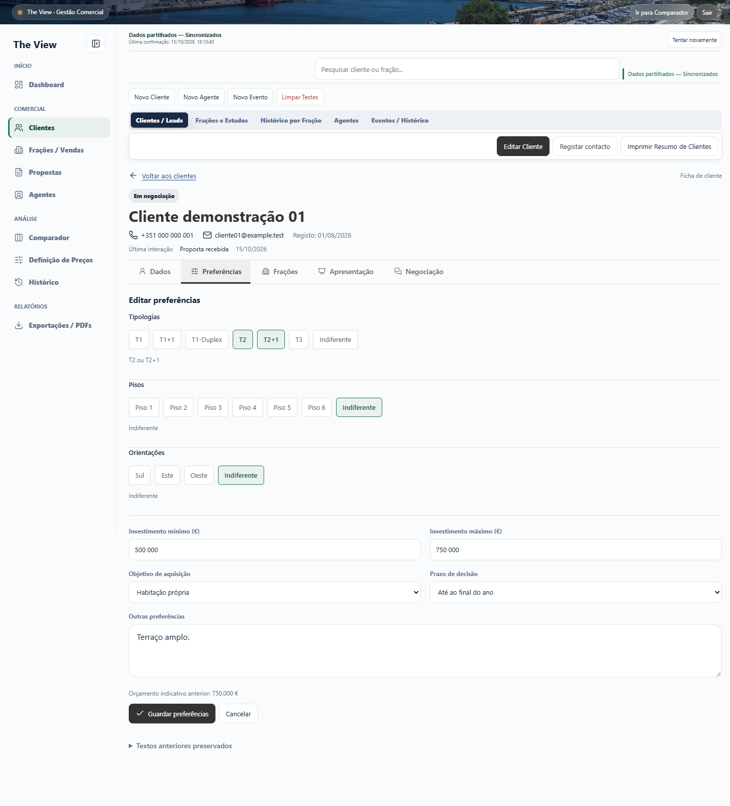
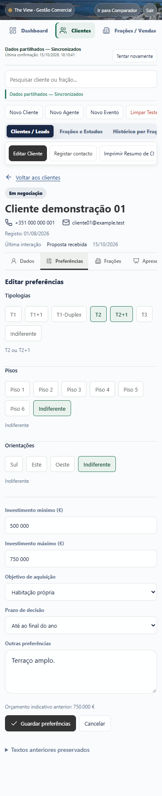

# Ficha completa: correcao de navegacao e componentes

## Causa reproduzida

No codigo integrado em `main` (`4b452ce`), os cinco separadores eram renderizados tanto na pre-visualizacao da listagem como na ficha completa. Os componentes novos so substituiam os paineis antigos quando `commercialUx.clientProfileOpen` era verdadeiro. A selecao inicial e o refresh deixavam esse estado falso: o contexto guardava o cliente, mas nao a ficha aberta nem o separador. O botao Editar preferencias encaminhava entao para o modal legado. Clicar explicitamente no cartao abria o editor novo. Estes tres casos foram reproduzidos num Chrome real com dados ficticios antes da alteracao.

## Correcao

- Os componentes aprovados sao os mesmos na selecao inicial e na ficha completa; o estado de layout deixou de escolher a implementacao funcional.
- Escolher um separador ou iniciar uma acao abre a ficha completa. A rota de preferencias do modal antigo encaminha para o editor inline.
- O contexto de navegacao em sessionStorage conserva ficha aberta e separador; contextos antigos continuam aceites. Nao houve migracao nem alteracao do modelo comercial.
- Modulos obrigatorios ausentes/incompletos e uma interface de workflow invalida produzem erro explicito, sem paineis legados. Criacao/edicao de clientes, eventos e contacto ficam bloqueadas. Recarregar e regressar a carteira continuam acessiveis.
- Mantidos os modais de identidade, documentacao e eventos historicos que continuam necessarios. Nao foi reimplementado qualquer fluxo comercial.
- A configuracao Git da Vercel bloqueia o deployment automatico exclusivamente da branch corretiva.

## Evidencia visual real

Todas as imagens usam exclusivamente dados ficticios, API autenticada local e Apps Script simulado em memoria. Nenhuma captura contem a base comercial real. Computador: 1440x1000; telemovel: 390x844. Imagens completas podem exigir abrir o ficheiro para ampliar.

| Separador | Computador | Telemovel |
| --- | --- | --- |
| Dados: Estado do Contacto, prioridade e formulario de contacto | [Abrir](desktop-dados.png) | [Abrir](mobile-dados.png) |
| Preferencias: selecao multipla, Indiferente e investimento | [Abrir](desktop-preferencias-multiplas.png) | [Abrir](mobile-preferencias-multiplas.png) |
| Fracoes: recomendacoes, alternativas +5% e pesquisa das 39 | [Abrir](desktop-fracoes.png) | [Abrir](mobile-fracoes.png) |
| Apresentacao: registo realizado, preco comunicado e versoes | [Abrir](desktop-apresentacao.png) | [Abrir](mobile-apresentacao.png) |
| Negociacao: contraproposta editavel e historico da fracao | [Abrir](desktop-negociacao.png) | [Abrir](mobile-negociacao.png) |

[Carteira](desktop-listagem.png) · [Entrada na ficha](desktop-entrada-ficha.png) · [Regresso desktop](desktop-regresso-listagem.png) · [Regresso mobile](mobile-regresso-listagem.png) · [Erro de modulo indisponivel](desktop-modulo-indisponivel.png)

### Preferencias em computador

### Preferencias em telemovel

## Validacao e reproducao

- `node tests/commercial-profile-routing-browser.mjs`: selecao inicial sem clicar no cartao, carteira, cinco componentes reais, formularios principais, selecao multipla, cancelar, refresh/reabertura e regresso em desktop/mobile. Cancelar/navegar nao grava. Falha dos quatro modulos e factory invalida: erro explicito e zero gravacoes. [Resultados](results.json).
- `node tests/commercial-pr6-regression-browser.mjs`: selecao 9/24/30, apresentar so 24, editar/recarregar preservando 9/30; historico de contacto sem substituir decisao manual; sincronizacao com segunda sessao.
- `node tests/commercial-client-complete-browser.mjs`: apresentacoes preparadas/realizadas/repetidas, propostas e contrapropostas, reserva/cancelamento/venda com agente, confirmacao cancelada sem escrita, outro titular bloqueado, corrida de disponibilidade, conflito 409, cache preservada e recuperacao de falhas.
- `node tests/commercial-client-complete-regression.cjs`: 24 suites Node, sintaxe de commercial.js/app.js/config.js e verificacao de ficheiros protegidos e bloco de sincronizacao inalterados.

Os testes browser usam `tests/helpers/client-complete-preview.cjs`, porta localhost 5197, com valores de teste definidos nesse helper e todas as escritas em memoria. Definir PLAYWRIGHT_MODULE e CHROME_EXECUTABLE conforme o runtime local. Nao apontar os testes para producao. O teste comercial extenso permite COMPLETE_ARTIFACTS para guardar os seus resultados fora das galerias anteriores.

## Limites e seguranca

Nao houve acesso aos 65 clientes/90 eventos reais, precos ou estados de producao. API, Apps Script, autenticacao, config.js, data.json, plantas e protocolo de sincronizacao nao foram alterados. O estado da navegacao e apenas UI. Um refresh nao recupera campos de um formulario cancelado/nao guardado: restaura a ficha e o separador. A validacao e local; nao certifica a versao ou o cache de qualquer deployment remoto. Nao houve merge, promocao ou deployment nesta correcao.
