# CRM integrado: evidencias visuais

Capturas novas desta integracao, em Chrome real, com fonte ficticia em memoria.
Nao foram usados clientes reais, Google Sheets ou credenciais de producao.
Referencia visual/funcional: ZIP pos-auditoria de 19/10/2026, sem novo redesenho.

Imagens atualizadas na consolidacao definitiva da PR17: Dados inclui novamente
acompanhamento/proxima acao; Procura e Oportunidades usam exclusivamente os
componentes atuais. Desktop 1440x900, portatil 1366x768, tablet 820x1080 e mobile 390x844.

## Desktop

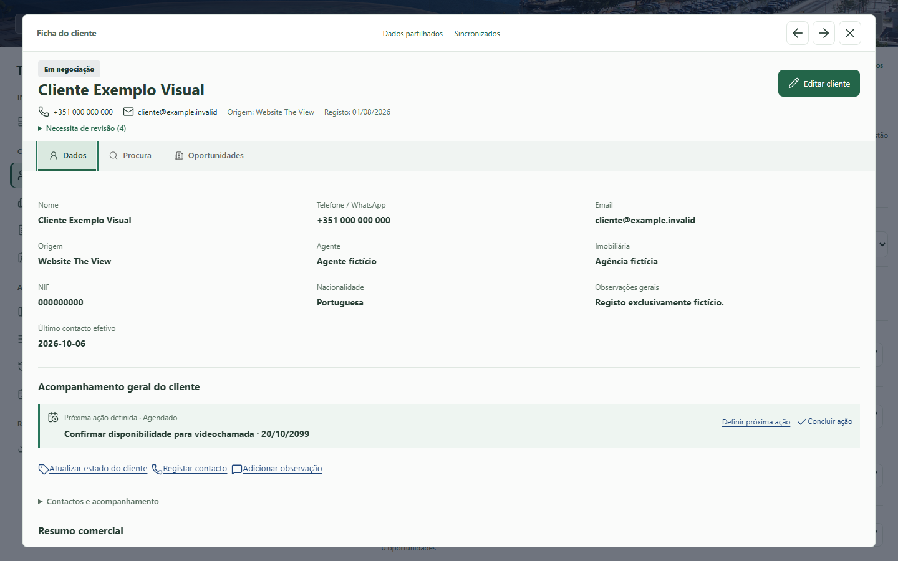
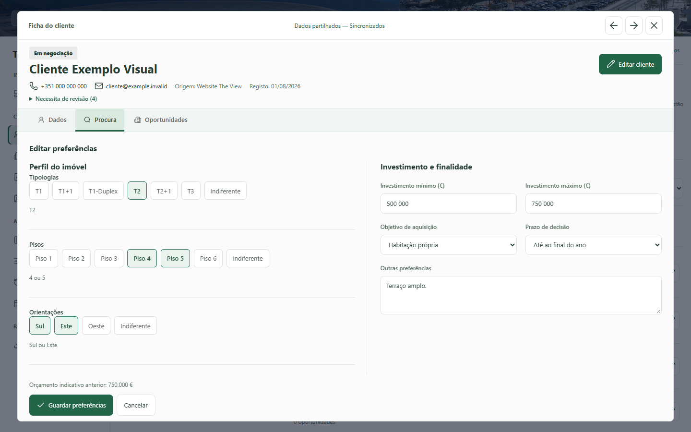
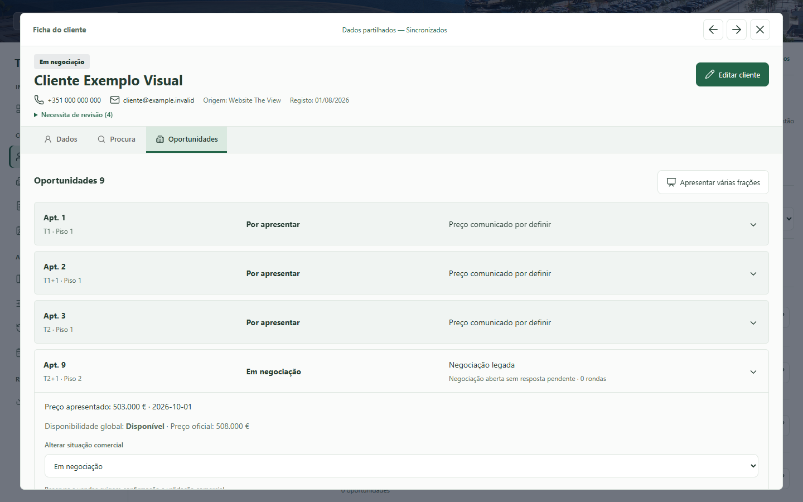
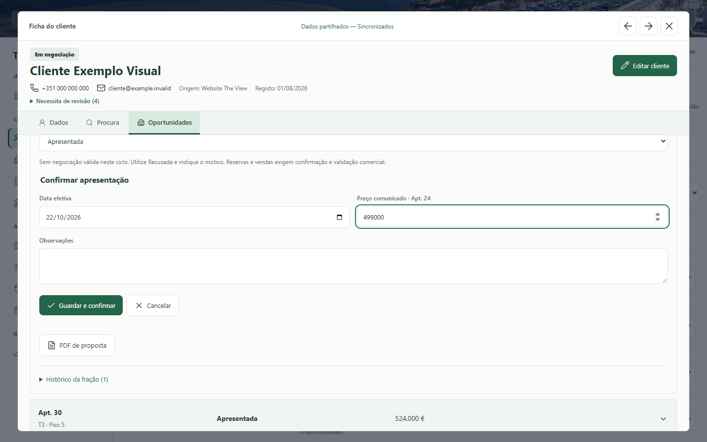
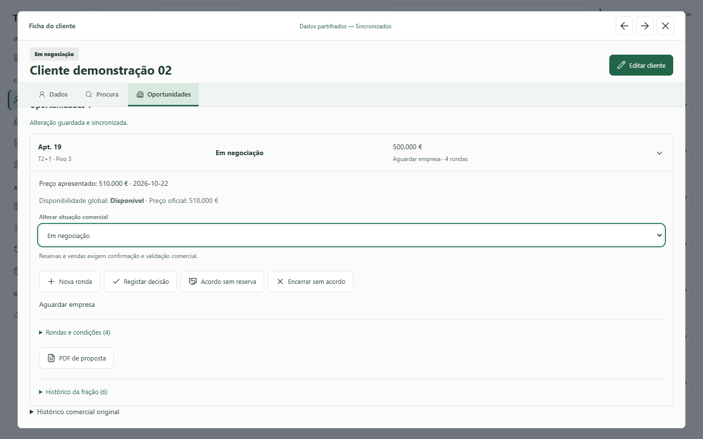
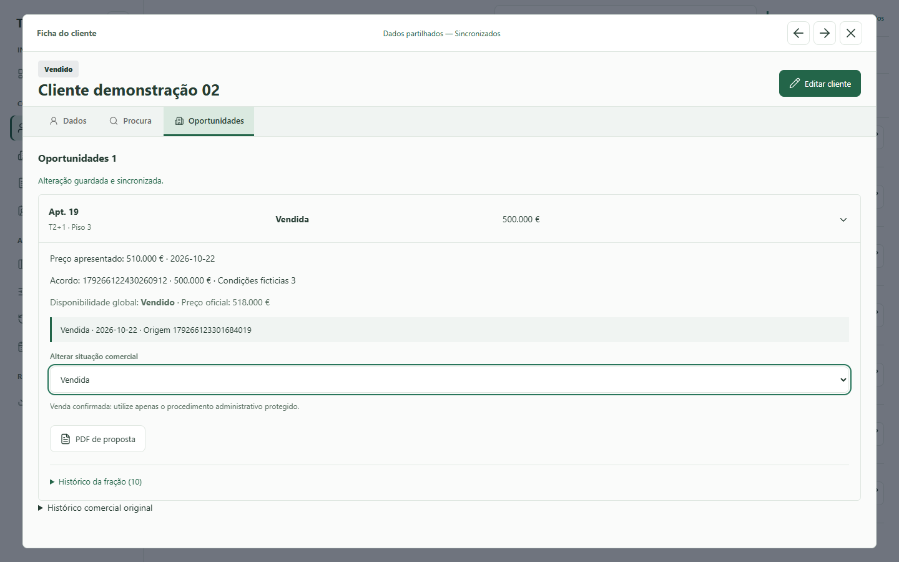
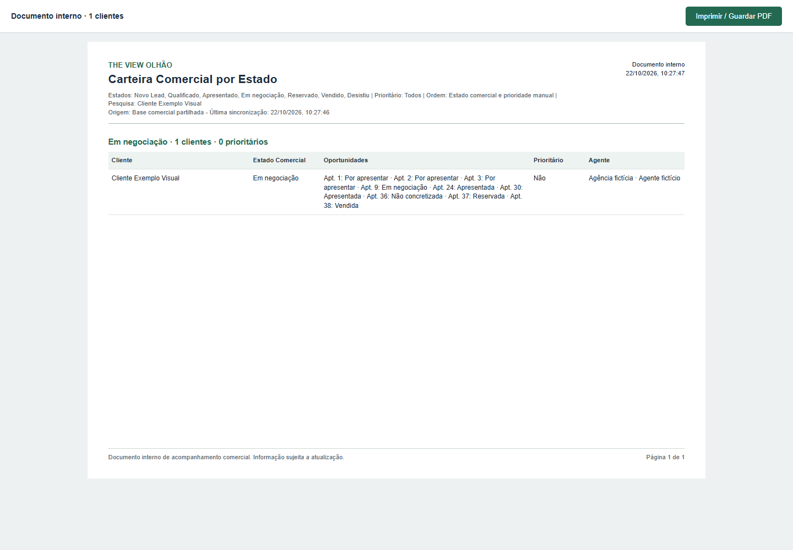

## Portatil e tablet

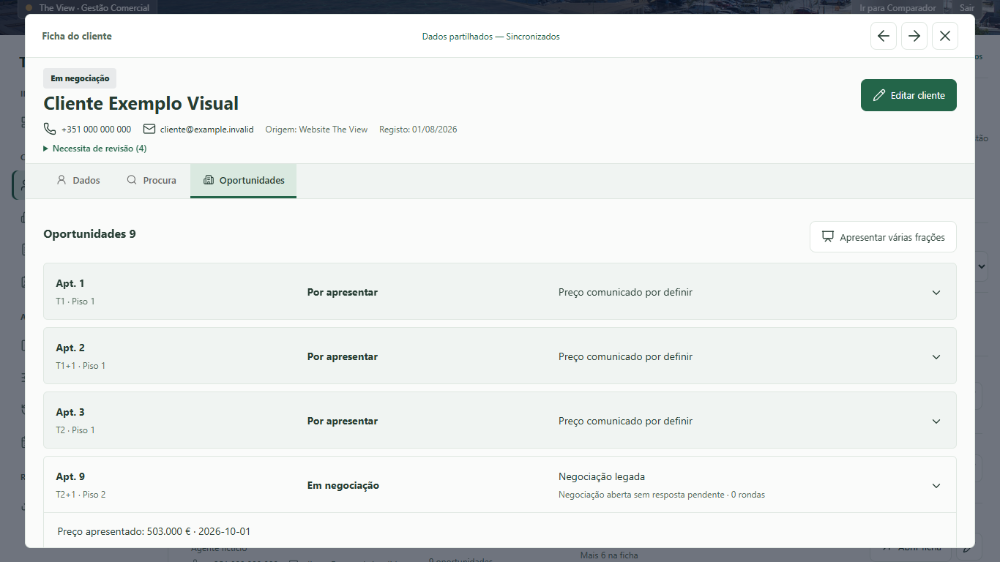
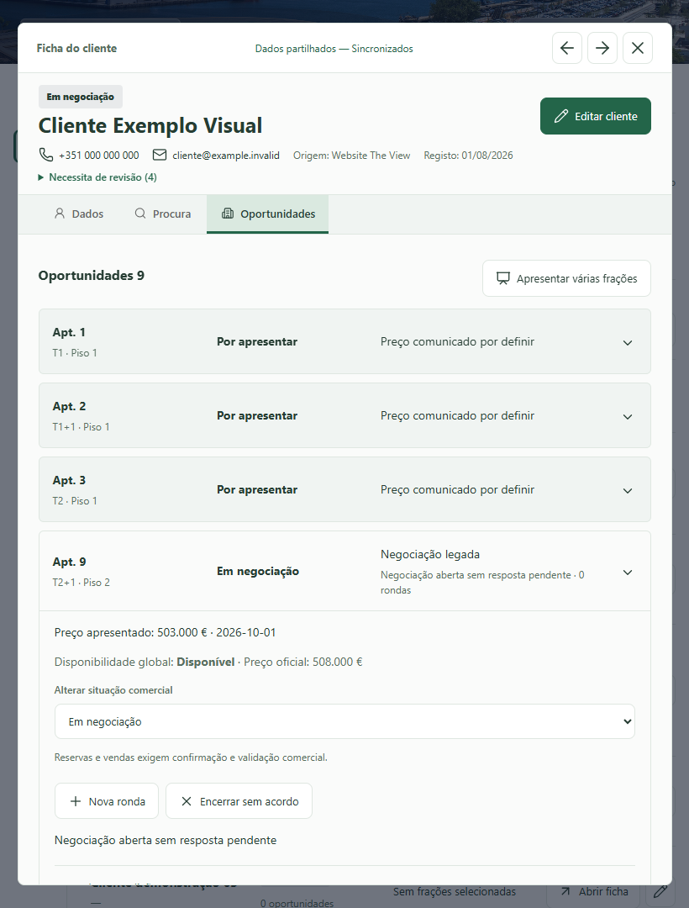

## Mobile

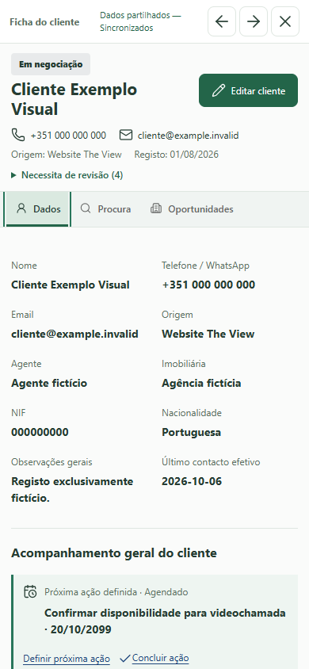
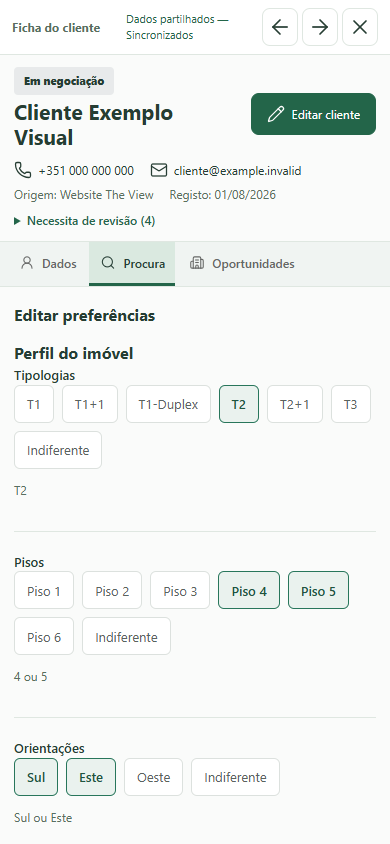
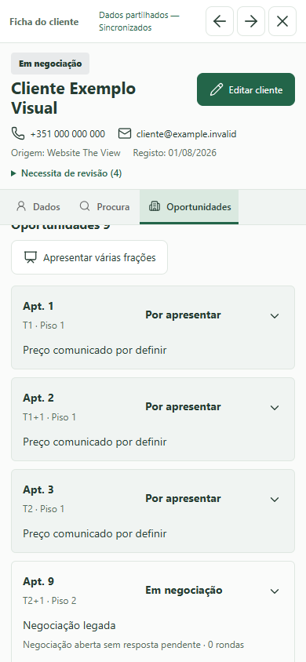
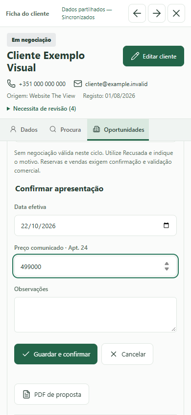

Resultados atuais e classificacao das suites: [CRM_CONSOLIDATION_PR17.md](../../CRM_CONSOLIDATION_PR17.md).

Arquivo da primeira integracao: [CRM_OPPORTUNITY_INTEGRATION.md](../../CRM_OPPORTUNITY_INTEGRATION.md).
