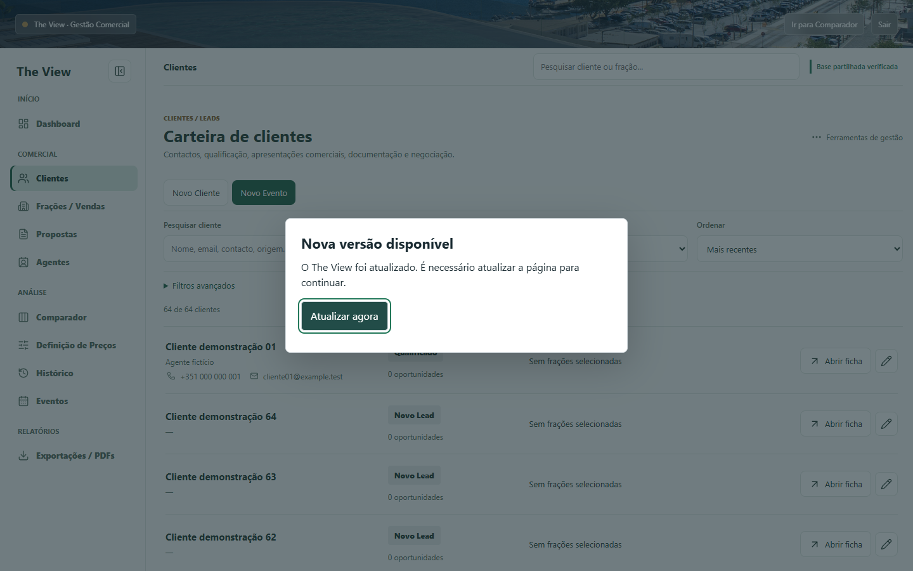
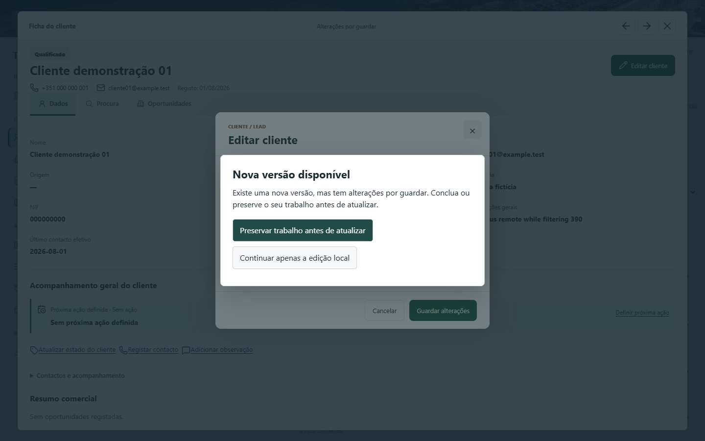
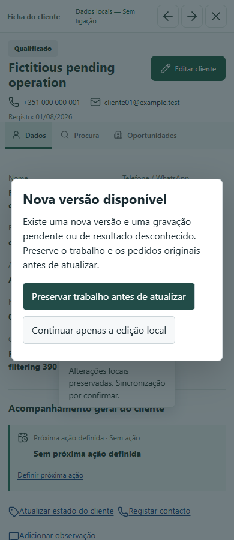

# Consultas e atualizacao obrigatoria

Capturas reais do Chrome, exclusivamente com clientes, agentes e dados analiticos ficticios. Nao sao imagens de producao nem simulacoes graficas.

## Sem trabalho pendente (desktop)

## Formulario ainda nao guardado

O teste descarrega o ficheiro, verifica os campos ainda nao persistidos, recusa um ficheiro alterado e so atualiza apos selecionar o ficheiro exato com o trabalho ainda igual.

## Sem trabalho pendente (mobile, 390 px)

## Pedido pendente (mobile)

## Resultados

[Resumo consolidado](validation-summary.json), [Node](node-results.json), [catalogo completo](browser-catalog.json), [repeticoes dos testes interrompidos](browser-recovery-reruns.json), [repeticoes finais](browser-final-reruns.json) e [comportamentos verificados](deployment-results.json).

[Relatorio, limites e procedimento de publicacao futura](../../DEPLOYMENT_UPDATE.md). Sem merge, deployment ou Google Sheets real.
