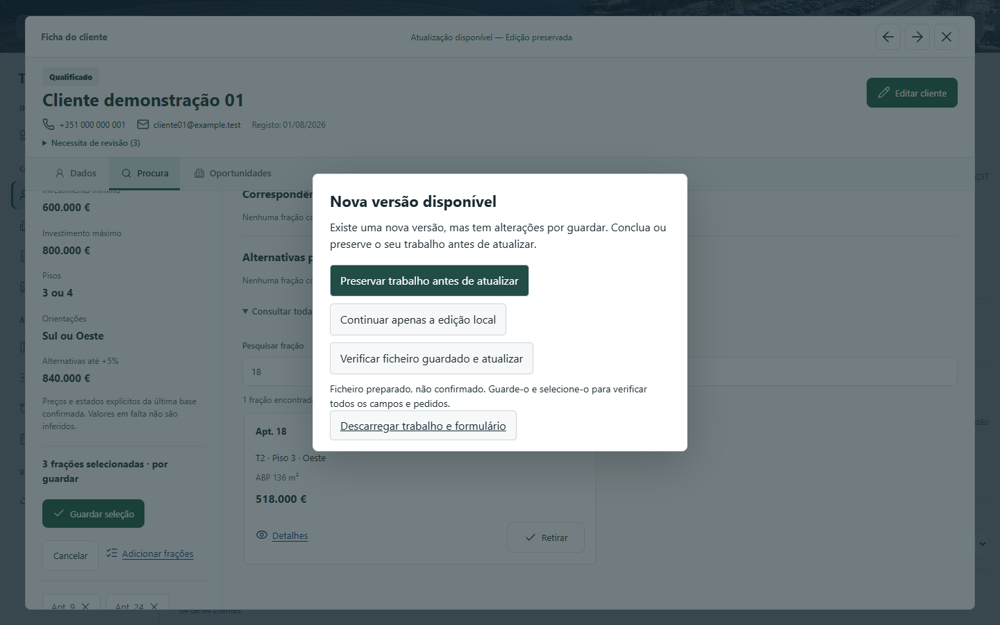
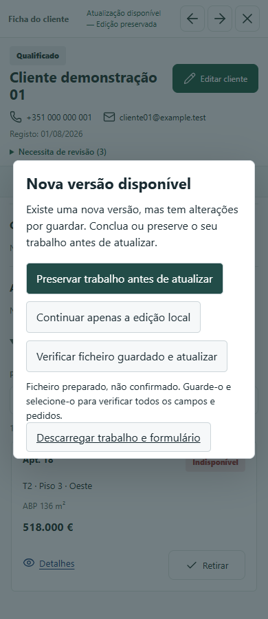
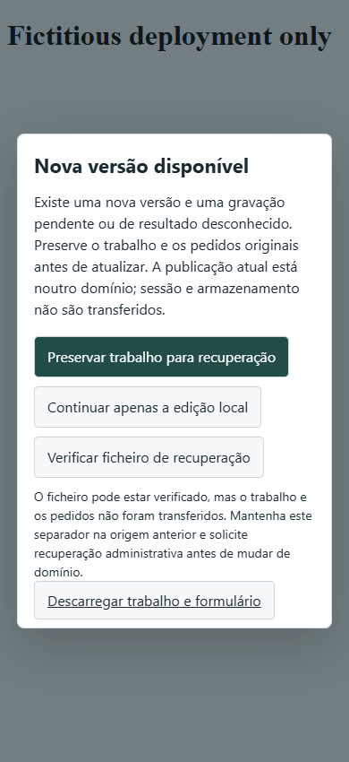
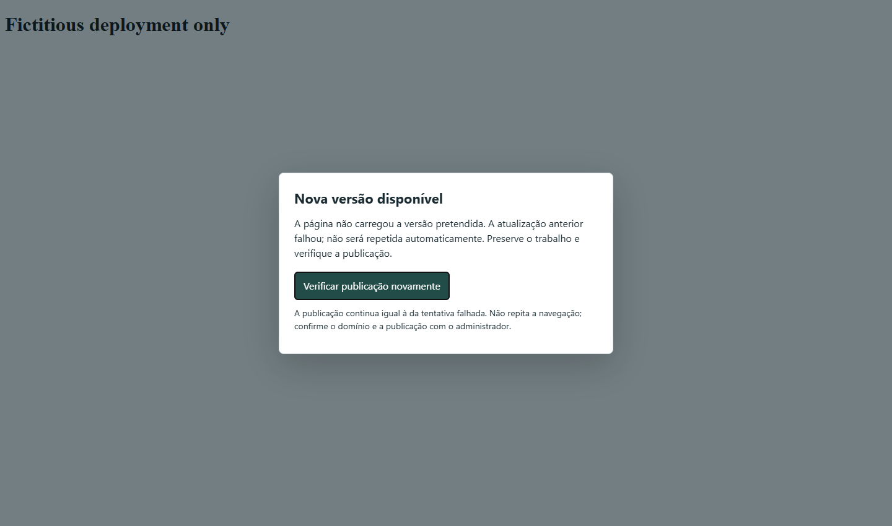

# PR25 - Rascunhos e atualizacao entre origens

Evidencia obtida em Chrome headless real. Todos os clientes, contactos, precos e pedidos dos testes sao ficticios. As origens HTTPS `.fixture.invalid` sao integralmente respondidas pelo Playwright, sem acesso a Vercel/Google. As duas primeiras capturas mostram o CRM local; as restantes mostram o monitor real numa pagina minima isolada, nao um deployment publicado.

## Capturas

Selecao modificada protegida, antes da atualizacao (desktop):



Selecao modificada protegida (mobile):



Origem imutavel antiga: mesmo apos verificar o ficheiro, o pedido pendente impede mudar de dominio:



Uma navegacao que volta a carregar a versao antiga nao e repetida automaticamente:



## Reproducao

Resultado final: **65/65 suites Node, 31/31 suites de navegador e 150/150 verificacoes de sintaxe aprovadas; zero falhas finais.** O catalogo existente de 30 suites e a nova suite foram executados em grupos separados. Atualizacao obrigatoria e arquivo foram novamente executados apos a ultima alteracao de codigo, ambos aprovados. Sem erros JavaScript na suite nova, acesso a Google/Vercel reais ou POST comercial ao consultar/selecionar.

As falhas iniciais na construcao da suite nova foram corrigidas no proprio teste: codificacao UTF-8 da pagina HTTPS ficticia, ficha automaticamente reaberta e tentativa de exportar enquanto uma aprovacao ainda estava em curso. A primeira expectativa de catalogo passou a incluir a 31.a suite, mantendo todas as anteriores. Nao se suprimiu nenhuma verificacao de seguranca.

Com Node e Playwright/Chrome disponiveis, executar na raiz da branch (apenas fixtures locais; nao executar builds sobre ficheiros de producao):

```powershell
node tests/commercial-client-complete-regression.cjs
node tests/commercial-browser-regression.cjs
```

No ambiente de validacao foram definidos `PLAYWRIGHT_MODULE`, `CHROME_EXECUTABLE` e `NODE_PATH` para os runtimes locais, `COMMERCIAL_TEST_PORT=53397` (catalogo existente) / `53398` (suite nova), e diretorios de artefactos exteriores ao repositorio. O runner inicia e termina o servidor isolado de cada suite. Nunca utiliza a preview existente nem a Google Sheet.

Para repetir apenas os cenarios novos e os diretamente afetados:

```powershell
node tests/commercial-fraction-draft.test.js
node tests/commercial-browser-regression.cjs commercial-fraction-origin-browser.mjs commercial-deployment-browser.mjs commercial-recovery-archive-browser.mjs
```

Os resultados completos sao reunidos em `validation-results.json`; os detalhes novos estao em `fraction-origin-results.json`. Nenhum ficheiro exportado com uma base comercial integral e incluido nesta galeria.
